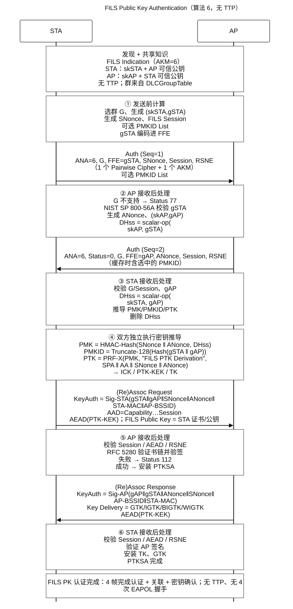
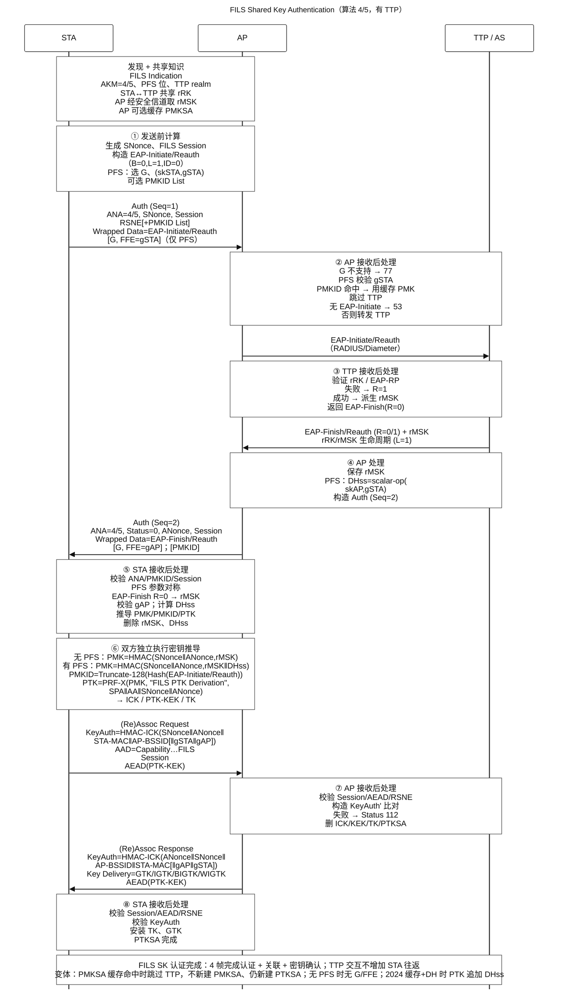

# FILS 认证协议 UML 序列图（Mermaid）

> 版式参照 WCNC 2019 论文 Figure 1；消息内容按 IEEE 802.11ai / 802.11-2024 §12.11 与最初整理的 FILS 流程。

## 路径 A：FILS Public Key Authentication（算法 6，无 TTP）

## 路径 B：FILS Shared Key Authentication（算法 4/5，有 TTP）

