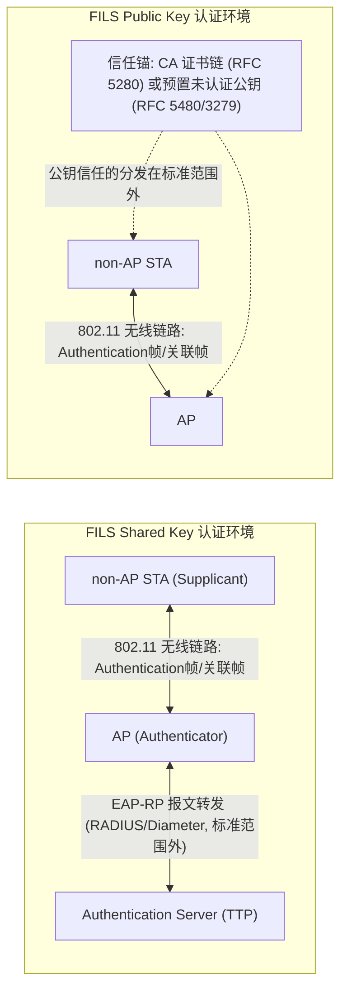
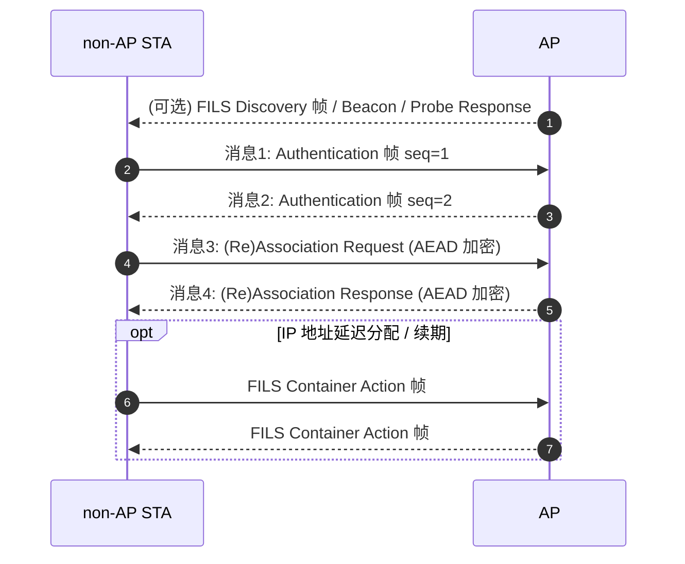
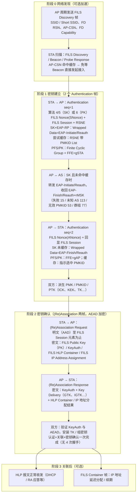
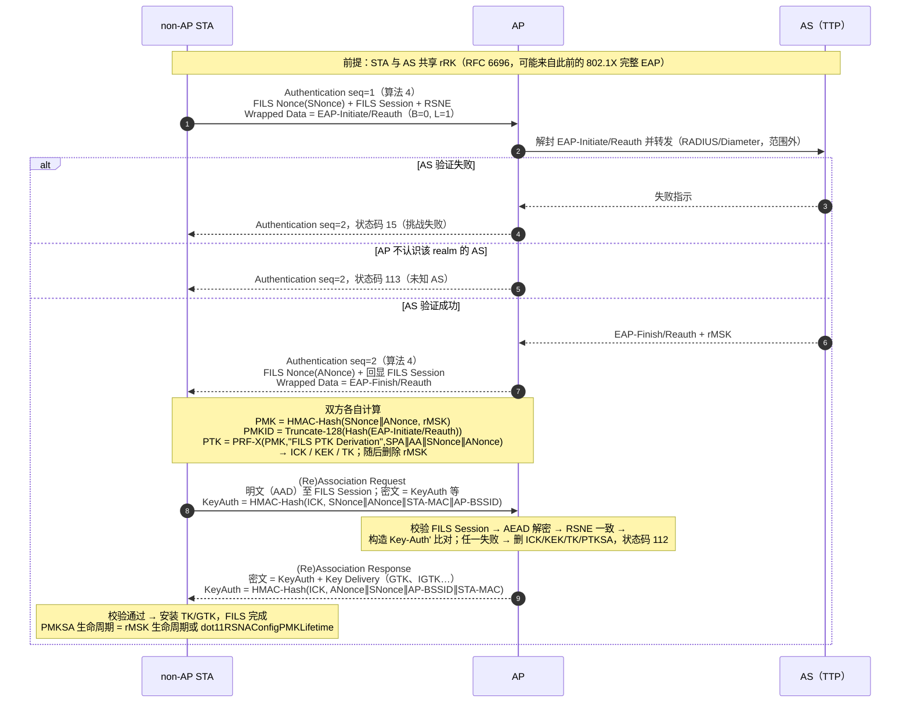
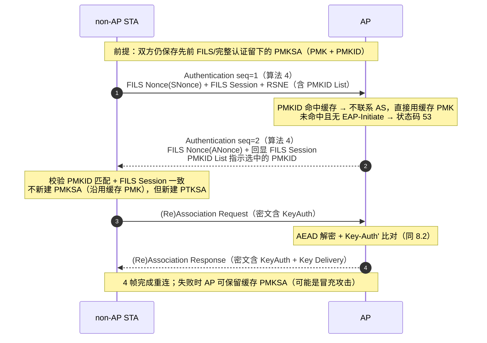
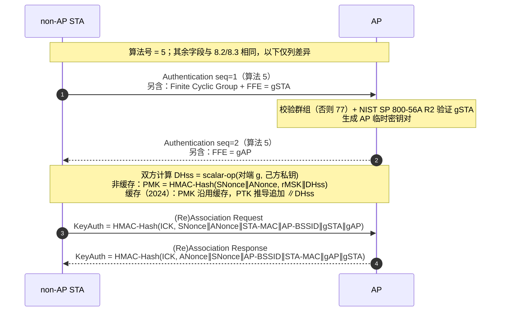
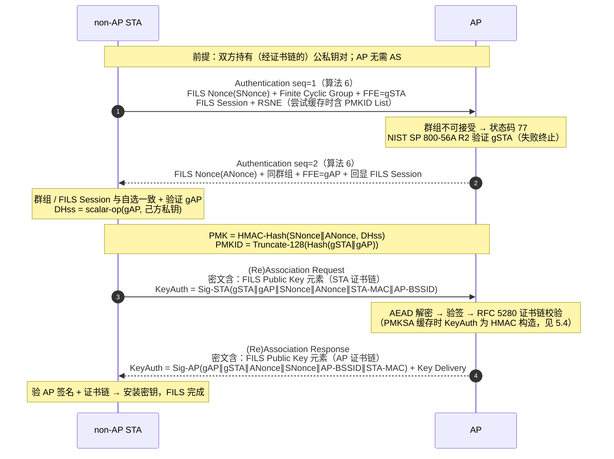
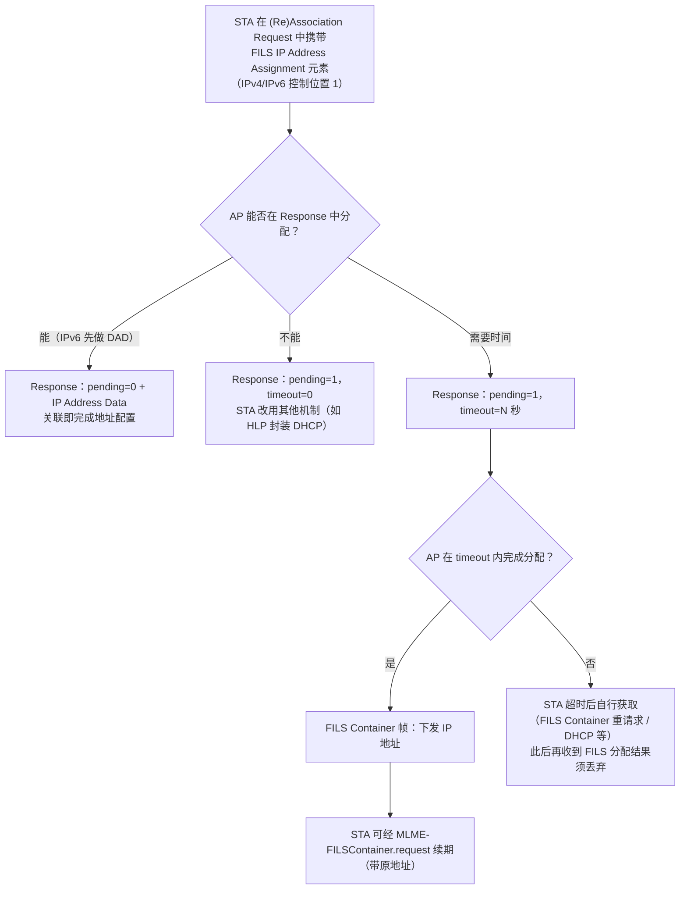
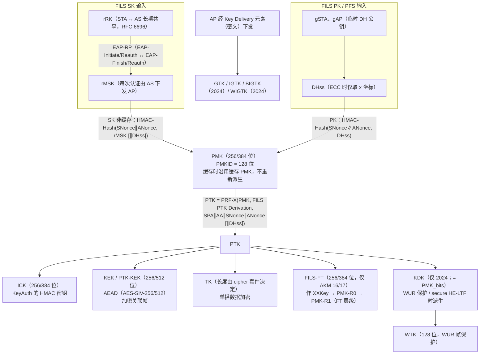

# FILS（快速初始链路建立）协议分析

> 依据文档：
> - IEEE Std 802.11ai-2016（Amendment 1: Fast Initial Link Setup，FILS 原始修正案，全文条款号以 "ai" 标注）
> - IEEE Std 802.11-2024（当前合并版本，FILS 认证位于第 12.11 条，条款号以 "2024" 标注）
>
> 本文以 802.11ai-2016 的结构为主线整理，并标注 802.11-2024 中的对应条款与差异。

---

## 目录

1. [概述](#1-概述)
2. [协议实体](#2-协议实体)
3. [实体的共享知识（协议前提）](#3-实体的共享知识协议前提)
4. [会话消息与逐字段定义](#4-会话消息与逐字段定义)
5. [密钥体系与推导](#5-密钥体系与推导)
6. [实体接收到消息后的处理](#6-实体接收到消息后的处理)
7. [辅助机制](#7-辅助机制)
8. [协议流程图](#8-协议流程图)
9. [附录](#9-附录)

---

## 1. 概述

### 1.1 FILS 的目标

FILS（Fast Initial Link Setup，快速初始链路建立）将传统 WLAN 初始接入所需的多个往返过程（开放认证 → 关联 → IEEE 802.1X/EAP 完整认证 → 4 次握手 → DHCP/RS 等高层配置）压缩为**仅 4 个帧**的交换，一次性完成：

- STA 与 AP（及认证服务器）的**双向认证**；
- PMK/PTK 的**密钥建立**与**密钥确认**（产生 PTKSA，关联后直接可用于数据加密，无需 4 次握手）；
- 可选的**高层协议（HLP）承载**与 **IP 地址配置**（关联帧内完成，替代 DHCP 等后续交互）。

> 原文（ai 4.10.3.6.1 / 2024 4.10.3.6）：FILS authentication allows faster link setup to the network by performing authentication, association, and key confirmation using four frames—two Authentication frames, one (Re)Association Request frame, and one (Re)Association Response frame.

### 1.2 两种认证协议

FILS 定义了**两种认证协议**（三种使用形态），通过 Authentication 帧中的 Authentication Algorithm Number 区分（ai 9.4.1.1 / 2024 12.11）：

| 协议 | 算法号 | 共享秘密来源 | PFS（前向安全） | 是否需要 AS |
|---|---|---|---|---|
| FILS Shared Key 认证（FILS SK，无 PFS） | 4 | rRK（EAP-RP，RFC 6696）或缓存 PMKSA | 无 | 无缓存 PMKSA 时需要 |
| FILS Shared Key 认证（FILS SK，带 PFS） | 5 | 同上 + DH 交换 DHss | 有 | 同上 |
| FILS Public Key 认证（FILS PK） | 6 | DH 交换 DHss + 双方公钥签名 | 始终有 | 不需要（AP/STA 直接互认） |

AKM 套件（RSNE 中协商，ai Table 9-133 / 2024 Table 9-190）：

| AKM 套件 | 含义 | 哈希 | AEAD 模式 |
|---|---|---|---|
| 00-0F-AC:14 | FILS 密钥管理，SHA-256 + AES-SIV-256 | SHA-256 | AES-SIV-256 |
| 00-0F-AC:15 | FILS 密钥管理，SHA-384 + AES-SIV-512 | SHA-384 | AES-SIV-512 |
| 00-0F-AC:16 | **FT over FILS**，SHA-256 + AES-SIV-256 | SHA-256 | AES-SIV-256 |
| 00-0F-AC:17 | **FT over FILS**，SHA-384 + AES-SIV-512 | SHA-384 | AES-SIV-512 |

### 1.3 两份标准文档的关系

| 项目 | 802.11ai-2016 | 802.11-2024 |
|---|---|---|
| 性质 | FILS 原始修正案（以"编辑指令"形式书写） | 合并所有修正案后的完整现行标准 |
| FILS 认证协议 | 12.12 | 12.11 |
| Authentication 帧体表 | Table 9-35 / 存在性 Table 9-36 | Table 9-70 / 存在性 Table 9-71 |
| FILS 流程 | 11.47 | 11.45（Discovery、HLP、IP 配置、DILS 等） |
| FILS 元素定义 | 9.4.2.176–9.4.2.190 | 9.4.2.174–9.4.2.188（编号顺移） |

主要技术差异（详见 5.7 节）：2024 版 PTK 推导公式在 PMKSA 缓存 + DH 交换时**追加了 `|| DHss`**；新增 KDK/WTK 推导（WUR 帧保护、安全 HE-LTF）；"FILS Wrapped Data 元素"更名为"Wrapped Data 元素"；Key Delivery 元素增加 BIGTK/WIGTK KDE 等。

### 1.4 FILS STA 的基本约束（ai 11.47.1）

- FILS 仅支持**非 DMG 的基础架构 BSS**（infrastructure BSS）；
- FILS STA 必须是 QoS STA（dot11QosOptionImplemented = true）；
- FILS non-AP STA 须在 Probe Request / (Re)Association Request 的 Extended Capabilities 元素中置 FILS Capability 位（bit 72）为 1；
- FILS AP 必须在 Beacon、Probe Response、(Re)Association Response 中包含 **FILS Indication 元素**，并可发送 FILS Discovery 帧；
- 使能开关：dot11FILSActivated。

---

## 2. 协议实体

### 2.1 实体清单

| 实体 | 别名/角色 | 说明 | 参与的协议 |
|---|---|---|---|
| **non-AP STA** | Supplicant（恳求者）；内部含 S0KH/S1KH 密钥持有者功能（FT over FILS 时） | 发起 FILS 的客户端站点。构造 Authentication seq 1、(Re)Association Request；派生 PMK/PTK；验证 AP | FILS SK、FILS PK |
| **AP** | Authenticator（认证者）、FILS AP | 接入点。转发/解封装 EAP-RP；构造 Authentication seq 2、(Re)Association Response；派生 PMK/PTK；分发 GTK/IGTK | FILS SK、FILS PK |
| **Authentication Server（AS）** | TTP（Trusted Third Party，可信第三方） | 仅 FILS SK（非 PMKSA 缓存路径）需要。持有与 STA 共享的 rRK，执行 EAP-RP（RFC 6696）验证并返回 rMSK。AP 与 AS 之间的传输（RADIUS/Diameter 等）在标准范围之外 | 仅 FILS SK |



要点：

- **FILS PK 不需要 AS**：STA 与 AP 通过各自的（经证书或预置方式可信的）公钥直接互相认证（签名验证 + 证书链检查，RFC 5280）（ai 4.10.3.6.3）。
- **FILS SK 有两条路径**：
  1. **EAP-RP 路径**：STA 与 AS 通过 AP 中继 EAP-Initiate/Re-auth 与 EAP-Finish/Re-auth 报文，验证双方共同持有 rRK；
  2. **PMKSA 缓存路径**：STA 与 AP 之间直接使用先前 FILS 认证缓存的 PMKSA，此时不需要 AS 参与（ai 4.10.7）。
- 若 SK 的两个前提都不满足，则需先经 IEEE 802.1X 完整 EAP 认证建立 rRK（此时认证算法号为 0，开放系统认证）。

### 2.2 FILS AP 的能力宣告（实体向对端公开的知识入口）

AP 通过以下帧宣告 FILS 能力（ai 12.12.2.2 / 11.47.4）：

| 载体 | 携带内容 |
|---|---|
| Beacon / Probe Response | RSNE（AKM 套件 14–17）+ **FILS Indication 元素**（必选）+ 可选 CAG Number、AP-CSN、Differentiated Initial Link Setup 元素 |
| FILS Discovery 帧 | FILS Discovery Information 字段（精简系统信息），可选携带 FD RSN Information 子字段 + FILS Indication 元素 + RNR 元素 |

FILS Indication 元素中与实体能力相关的位：

- FILS Shared Key authentication without PFS Supported 位
- FILS Shared Key authentication with PFS Supported 位
- FILS Public Key Authentication Supported 位
- FILS IP Address Configuration 位（AP 是否支持 FILS IP 地址配置）
- Cache Identifier Included 位 + Cache Identifier 字段（PMKSA 缓存域标识）
- HESSID Included 位 + HESSID 字段（同源 ESS 标识）
- Number of Realm Identifiers（最多 7 个 2 字节哈希 realm）
- Number of Public Key Identifiers（最多 7 个 AP 公钥指示符）

STA 据此判断可否启动某一种 FILS 认证协议（realm 匹配 → SK；信任 AP 公钥 → PK；共享 PMKSA → SK 缓存路径）。

---

## 3. 实体的共享知识（协议前提）

协议安全性明确依赖以下假设（ai 12.12.1）：

> - 使用 FILS SK 时，每个 STA 与一个能执行 EAP-RP 的 TTP 共享有效 rRK，或持有先前已认证连接缓存的 PMK；
> - 使用 FILS PK 时，每个 STA 具备信任对方 STA 公钥的手段；
> - 使用 PFS 时，协商出一个求解离散对数计算上不可行的有限循环群；
> - 使用 PFS 时，STA 与 AP 在 dot11RSNAConfigDLGroupTable 中至少共同支持一个有限循环群。

### 3.1 FILS SK 协议的共享知识

| 共享知识 | 共享方 | 内容与来源 | 用途 |
|---|---|---|---|
| **rRK**（reauthentication Root Key） | STA ↔ AS | 由先前一次完整 EAP 认证派生（RFC 5295/6696），可多次用于 EAP-RP | EAP-Initiate/Re-auth 与 EAP-Finish/Re-auth 报文的 MAC 与加密；派生 rMSK |
| **缓存 PMKSA**（PMK + PMKID） | STA ↔ AP | 先前 FILS 认证成功后缓存；用 PMKID 标识；Cache Identifier（2 字节不透明串，ESS 内每个 authenticator 唯一）标识缓存域 | 跳过 EAP-RP 直接派生新 PTKSA |
| **有限循环群表** | STA ↔ AP | dot11RSNAConfigDLGroupTable，PFS 时须至少一个共同群 | DH 交换（算法 5） |
| **AKM 套件 / 哈希 / AEAD 算法** | STA ↔ AP | RSNE 协商 00-0F-AC:14/15（或 16/17） | 决定 Hash（SHA-256/384）、AES-SIV-256/512、密钥长度 |
| **Realm（域）匹配** | STA ↔ AP | AP 广播最多 7 个 2 字节哈希 realm；STA 以自身 NAI realm 计算 `H = L(SHA256(ToLowerCase(D)), 0, 16)`（D 为 RFC 1035 格式 realm，国际化域名先经 RFC 3490 转换）比较；也可借助 HESSID/ANQP 判断 | STA 判断 AS 是否持有自己的 rRK，从而决定是否发起 EAP-RP |
| MAC 地址 / BSSID / SSID | STA ↔ AP | 802.11 MAC 层基本信息 | 密钥推导输入、地址过滤 |

### 3.2 FILS PK 协议的共享知识

| 共享知识 | 共享方 | 内容与来源 | 用途 |
|---|---|---|---|
| **对方公钥的信任** | STA ↔ AP | 两种来源：① 双方持有 CA 签发的 X.509v3 证书（FILS Public Key 元素 Key Type=1，RFC 5280），能在 FILS 认证中校验对方证书链；② 先验地知道并信任对方的未认证公钥（Key Type=2，RFC 5480 编码；Key Type=3，RFC 3279 编码） | 验证对方 KeyAuth 签名；AP 公钥可通过 FILS Indication 的 Public Key Identifier（Key Type=1: 证书 Issuer；=2/3: 公钥的 SHA-256 哈希）预先匹配 |
| **各自私钥** | 各自私有 | 与被信任公钥配对 | 生成 KeyAuth 数字签名（RSA: RFC 3447；DSA: FIPS 186-4；ECDSA: ISO/IEC 14888-3） |
| **有限循环群表** | STA ↔ AP | dot11RSNAConfigDLGroupTable | PK 必做 DH 交换，产生 DHss |
| **AKM 套件 / 哈希 / AEAD 算法** | STA ↔ AP | 同上（PK 同样使用 14/15/16/17） | 同上 |

### 3.3 会话中双方生成的（非预先共享的）共同值

以下值在协议运行中生成，最终为双方共享：

| 值 | 生成方 | 说明 |
|---|---|---|
| SNonce | STA | 随机 16 字节，置于 FILS Nonce 元素 |
| ANonce | AP | 随机 16 字节，置于 FILS Nonce 元素 |
| FILS Session | STA | 随机 8 字节会话标识（FILS Session 元素），AP 原样回显 |
| rMSK | STA 与 AS | 由 EAP-RP 交换派生，AP 从 AS 处获得（SK/EAP-RP 路径） |
| DHss | STA 与 AP | 由 DH 交换计算（g^ab）；2024 版注明 ECDH 时仅取 x 坐标 |
| gSTA / gAP | STA / AP | 各自临时 DH 公钥，置于 FFE 字段 |
| PMK、PMKID、PTK(ICK/KEK/TK) | 双方各自推导 | 见第 5 章 |

---

## 4. 会话消息与逐字段定义

一次完整 FILS 会话的消息序列（4 帧 + 可选发现帧 + 可选后续 FILS Container 帧）：



### 4.1 阶段 0（可选）：FILS Discovery 帧

FILS Discovery 帧是一种 **Public Action 帧**（ai 9.6.8.36），由 AP 在 Beacon 间隔之间发送，让 STA 无需等待完整 Beacon/Probe Response 即可发现 BSS 并获知 FILS 能力。发送约束：

- 不得以 DSSS/HR-DSSS PPDU 发送；可作为 non-HT duplicate PPDU 发送（此时须含 Primary Channel 子字段）；
- 与 Beacon 帧的间隔及相邻 FILS Discovery 帧间隔不得小于 dot11FILSFDFrameBeaconMinimumInterval；
- 若超过 dot11FILSFDFrameBeaconMaximumInterval 未发送 Beacon/FD 帧，须排队发送其一（除非下一个 TBTT 临近）。

**帧体字段（Table 9-325a）：**

| 序 | 字段 | 长度 | 说明 |
|---|---|---|---|
| 1 | Category | 1 | Public 类别（Table 9-47） |
| 2 | Public Action | 1 | FILS Discovery 值（Table 9-307） |
| 3 | FILS Discovery Information | 变长 | 见下 |
| 4 | Reduced Neighbor Report 元素 | 可选 | 9.4.2.171 |
| 5 | FILS Indication 元素 | 可选 | 9.4.2.183（宣告 FILS 认证能力） |
| 6 | Roaming Consortium 元素 | 可选 | — |
| 7 | Vendor Specific 元素 | 0..n | — |

**FILS Discovery Information 字段（Figure 9-687a）：**

| 子字段 | 长度 | 说明 |
|---|---|---|
| FILS Discovery Frame Control | 2 | 16 位控制位图，见下 |
| Timestamp | 8 | 帧源 TSF 定时器值；STA 据此计算下一 TBTT：`Next TBTT = Ceil(Timestamp/(Beacon Interval × 1024)) × (Beacon Interval × 1024)` |
| Beacon Interval | 2 | 信标间隔（TU） |
| SSID/Short SSID | 1–32 | Short SSID Indicator=1 时为 4 字节 Short SSID（CRC-32 按生成多项式 G(x)=x^32+x^26+x^23+x^22+x^16+x^12+x^11+x^10+x^8+x^7+x^5+x^4+x^2+x+1 对 SSID 计算、取反码）；否则为 SSID 本身 |
| Length | 0/1 | 本字段剩余部分的长度（供未来扩展时解析） |
| FD Capability | 0/2 | 见下 |
| Operating Class | 0/1 | 主信道操作类 |
| Primary Channel | 0/1 | 主信道号（non-HT duplicate PPDU 发送时存在） |
| AP-CSN | 0/1 | BSS 配置参数集版本号（9.4.2.182） |
| Access Network Options (ANO) | 0/1 | 按 9.4.2.92 Figure 9-440 |
| FD RSN Information | 0/5 | 精简 RSN 信息，见下 |
| Channel Center Frequency Segment 1 | 0/1 | 80+80 MHz 时频段 1 中心频率索引 |
| Mobility Domain | 0/3 | MDID(2) + FT Capability and Policy(1)（9.4.2.47） |

**FILS Discovery Frame Control 子字段（16 位，Figure 9-687b）：**

| 位 | 名称 | 说明 |
|---|---|---|
| B0–B4 | SSID Length | SSID/Short SSID 子字段长度减 1；Short SSID Indicator=1 时固定为 3 |
| B5 | Capability Presence Indicator | 1 = FD Capability 子字段存在 |
| B6 | Short SSID Indicator | 1 = SSID/Short SSID 字段承载 Short SSID |
| B7 | AP-CSN Presence Indicator | 1 = AP-CSN 子字段存在 |
| B8 | ANO Presence Indicator | 1 = ANO 子字段存在 |
| B9 | Channel Center Frequency Segment 1 Presence Indicator | — |
| B10 | Primary Channel Presence Indicator | 1 = Primary Channel 与 Operating Class 子字段存在 |
| B11 | RSN Information Presence Indicator | 1 = FD RSN Information 子字段存在 |
| B12 | Length Presence Indicator | 1 = Length 字段存在 |
| B13 | MD Presence Indicator | 1 = Mobility Domain 子字段存在 |
| B14–B15 | Reserved | — |

**FD Capability 子字段（16 位，Figure 9-687c）：**

| 位 | 名称 | 取值 |
|---|---|---|
| B0 | ESS | 同 Capability Information |
| B1 | Privacy | 同 Capability Information |
| B2–B4 | BSS Operating Channel Width | 0: 20/22 MHz（TVHT_W）；1: 40（TVHT_W+W）；2: 80（TVHT_2W）；3: 160 或 80+80（TVHT_4W 或 2W+2W）；4–7 保留 |
| B5–B7 | Maximum Number of Spatial Streams | 0:1；1:2；2:3；3:4；4:5–8；5–7 保留 |
| B8 | Reserved | — |
| B9 | Multiple BSSIDs Presence Indicator | Beacon/Probe Response 中是否有 Multiple BSSID 元素 |
| B10–B12 | PHY Index | 0: HR/DSSS；1: ERP-OFDM；2: HT；3: VHT 或 TVHT；4–7 保留 |
| B13–B15 | FILS Minimum Rate | 按 PHY Index 解释：HR/DSSS → 1/2/5.5/11 Mbps；ERP-OFDM → 6/9/12/18/24 Mbps；HT/VHT → MCS 0–4；4–7 保留 |

**FD RSN Information 子字段（40 位，Figure 9-687d）：**

| 子字段 | 位宽 | 说明 |
|---|---|---|
| RSN Capability | 16 | 同 RSNE 的 RSN Capabilities（Figure 9-256） |
| Group Data Cipher Suite Selector | 6 | 选择器值 0–13 → Table 9-130 套件类型；14–61 保留；62 Vendor Specific；63 未选择 |
| Group Management Cipher Suite Selector | 6 | 同上映射 |
| Pairwise Cipher Suite Selector | 6 | 同上映射 |
| AKM Suite Selector | 6 | 0: 沿用 Beacon/Probe Response RSNE 中 AKM；1: AKM 套件 14；2: AKM 套件 15；3: 14 或 15；4: AKM 套件 17；5–61 保留；62 Vendor Specific；63 未选择 |

> STA 若收到含 FD RSN Information 的 FILS Discovery 帧，即可直接对该 AP 发起 FILS 认证（ai 12.12.2.2）。

### 4.2 消息 1：Authentication 帧 seq=1（STA → AP）

由 STA 构造（FILS SK：ai 12.12.2.3.2；FILS PK：ai 12.12.2.4.2）。

**帧体（Table 9-35 / 2024 Table 9-70）中 FILS 用到的字段：**

| 序 | 字段 | 值 | 说明 |
|---|---|---|---|
| 1 | Authentication Algorithm Number | SK 无 PFS: **4**；SK 带 PFS: **5**；PK: **6** | 2 字节（9.4.1.1） |
| 2 | Authentication Transaction Sequence Number | **1** | 2 字节 |
| 3 | Status Code | 保留（不使用） | — |
| 10 | Finite Cyclic Group | 所选群编号 | 2 字节（12.4.4）；**算法 5 与算法 6 必带** |
| 14 | Finite field element (FFE) | STA 临时 DH 公钥 | 变长；按 12.4.7.2.4 元素到八位串转换编码；**算法 5 与算法 6 必带** |
| 18/17 | FILS Nonce 元素 | SNonce | 16 字节随机数 |
| 19/18 | FILS Session 元素 | 随机会话标识 | 8 字节，STA 随机选择 |
| 20/19 | FILS Wrapped Data 元素（2024 改名 Wrapped Data） | EAP-Initiate/Re-auth 报文 | 仅 SK 且尝试 EAP-RP 时携带 |
| 5 | RSNE | AKM 套件 + PMKID List | 必带；尝试 PMKSA 缓存时 PMKID List 列出候选 PMKID |
| 6 | MDE | MDID 等 | 仅 FT over FILS 初始移动域关联时携带 |

> 表 9-36（2024 Table 9-71）对每种算法×序号规定了字段 4 之后元素的存在性，摘要如下：
>
> - **算法 4, seq 1**：RSNE（必）+ MDE（FT 时）+ FILS Nonce（必）+ FILS Session（必）+ FILS Wrapped Data（必，即 EAP-RP 模式下必带；尝试缓存时也带）。
> - **算法 4, seq 2**：RSNE（必）；FILS Nonce、FILS Session、FILS Wrapped Data 仅在 Status=0 时携带；Association Delay Info 在 Status=0 且 AP 预计关联响应将延迟 >1 TU 时携带。
> - **算法 5, seq 1**：在算法 4 seq 1 基础上必带 Finite Cyclic Group 与 FFE。
> - **算法 5, seq 2**：Status=0 时必带 Finite Cyclic Group、FFE、RSNE、FILS Nonce、FILS Session、FILS Wrapped Data；MDE+FTE（FT 时）；Association Delay Info（如上）。
> - **算法 6, seq 1**：Finite Cyclic Group、FFE、RSNE、MDE（FT 时）、FILS Nonce、FILS Session。
> - **算法 6, seq 2**：Status=0 时 Finite Cyclic Group、FFE、RSNE、MDE+FTE（FT 时）、FILS Nonce、FILS Session、Association Delay Info（如上）。PK 不携带 Wrapped Data。

**STA 构造前的准备：**

- 选择随机 16 字节 nonce（SNonce）；
- 判定是否尝试 PMKSA 缓存：若是，生成 PMKID 标识列表（置于 RSNE 的 PMKID List 字段）；
- 尝试 EAP-RP 时，按 RFC 6696 构造 EAP-Initiate/Re-auth 报文，并遵从以下澄清：
  - EAP-RP Flags：**B 标志 = 0**（非引导消息）；**L 标志 = 1**（要求 TTP 在 EAP-Finish/Re-auth 中提供 rRK 与 rMSK 生命期）；**EAP Identifier = 0**；
  - Cryptosuite 字段不得置 1；
- 使用 PFS（算法 5/6）时：从 dot11RSNAConfigDLGroupTable 选择群，生成临时私钥，用群的 scalar-op（12.4.4.1）与生成元计算临时公钥 gSTA。

### 4.3 SK 专属：AP ↔ AS 的 EAP-RP 中继（标准范围外）

- AP 收到 Authentication seq 1 后，从 FILS Wrapped Data 元素解出 EAP-Initiate/Re-auth 报文，使用与 EAP 认证相同的传输协议转发给 AS（例如 RADIUS，RFC 2865；或 Diameter，RFC 6942）；
- AS 按 RFC 6696 处理，返回 EAP-Finish/Re-auth 报文；认证成功时随报文返回相应 **rMSK**；失败时返回失败指示；
- AP 将 EAP-Finish/Re-auth 封装进 Authentication seq 2 的 FILS Wrapped Data 元素发给 STA。

### 4.4 消息 2：Authentication 帧 seq=2（AP → STA）

由 AP 构造（FILS SK：ai 12.12.2.3.4；FILS PK：ai 12.12.2.4.4）。

**帧体字段：**

| 字段 | 成功（Status=0） | 失败 |
|---|---|---|
| Authentication Algorithm Number | 4/5/6（与请求一致） | 4/5/6（算法 5 不支持群时也回 5） |
| Authentication Transaction Sequence Number | **2** | 2 |
| Status Code | 0（成功） | **15**（challenge 失败/AS 认证失败）、**53**（无效 PMKID，未带 EAP-Initiate 且无匹配 PMKSA）、**77**（不支持的有限循环群）、**113**（未知认证服务器） |
| FILS Nonce 元素 | ANonce（AP 生成的 16 字节随机数） | 不携带 |
| FFE 字段 | gAP（AP 临时 DH 公钥；算法 5/6） | 不携带 |
| Finite Cyclic Group 字段 | 所用群（算法 5/6） | 不携带（77 场景除外） |
| RSNE | 必带；PMKSA 缓存路径时 PMKID List 含**选中的 PMKID** | 视场景 |
| FILS Wrapped Data 元素 | EAP-Finish/Re-auth（SK 且 EAP-RP 路径） | 不携带 |
| Association Delay Info 元素 | AP 预计 (Re)Association Response 将在 (Re)Association Request 之后 **>1 TU** 才发送时携带，值为最小关联响应延迟（TU 数，1 字节） | 不携带 |
| MDE + FTE | FT over FILS 初始移动域关联时携带 | — |

**AP 发送后的动作：**

- 若 PFS：用群的 scalar-op 以 STA 临时公钥 gSTA 与自己临时私钥计算 **DHss**；
- 随即进入密钥建立（12.12.2.5）。

### 4.5 消息 3：(Re)Association Request（STA → AP，密钥确认第 1 步）

由 STA 构造（ai 12.12.2.6.2）。该帧分为**明文部分（同时作为 AEAD 的 AAD）**与**AEAD 加密部分**：

- **明文/AAD 部分**：从 Capability Information 字段（含）到 **FILS Session 元素（含）**为止的全部内容；
- **加密部分**：FILS Session 元素之后的所有内容，用 KEK 以 AEAD（12.12.2.7）加密。

**帧体字段（基础部分，2024 Table 9-64 序 1–23 摘要）：**

| 序 | 字段 | 备注 |
|---|---|---|
| 1 | Capability Information | 能力位图 |
| 2 | Listen Interval | 监听间隔 |
| 3 | SSID | — |
| 4 | Supported Rates and BSS Membership Selectors | — |
| 5 | Extended Supported Rates and BSS Membership Selectors | 条件存在 |
| 6–7 | Power Capability / Supported Channels | 条件存在 |
| 8 | RSN (RSNE) | dot11RSNAActivated 时存在 |
| 9 | QoS Capability | FILS STA 必为 QoS STA |
| 10–23 | RM Enabled Capabilities、Mobility Domain（FT 时）、Supported Operating Classes、HT/VHT Capabilities、Extended Capabilities（含 FILS Capability bit 72）等 | 条件存在 |

**FILS 专属字段（明文到 FILS Session 为止；其余进入密文）：**

| 序 | 字段 | 加密状态 | 内容 |
|---|---|---|---|
| 24 | **FILS Session 元素** | 明文（AAD 边界，含） | 8 字节，与消息 1 相同值 |
| 25 | FILS Public Key 元素 | 密文 | 仅 PK：STA 的（经证书的）公钥 |
| 26 | **FILS Key Confirmation 元素** | 密文 | KeyAuth 字段（见 5.4） |
| 27 | FILS HLP Container 元素（0..n） | 密文 | HLP 报文封装（DHCP/RS 等），超长部分回退为关联后 Data 帧 |
| 28 | FILS IP Address Assignment 元素 | 密文 | IP 地址请求（可选） |
| 42 | Fast BSS Transition (FTE) | 密文 | 仅 FT over FILS（AKM 16/17） |
| 43 | RSNXE | 密文 | 条件存在（2024 版） |
| Last | Vendor Specific | 密文 | — |

**AEAD 加密参数（SK 与 PK 相同）：**

- 密钥：KEK；
- AAD（按顺序作为独立分量传入）：
  1. STA 的 MAC 地址；
  2. AP 的 BSSID；
  3. SNonce；
  4. ANonce；
  5. (Re)Association Request 帧中从 Capability Information 字段（含）到 FILS Session 元素（含）的内容；
- 明文：FILS Session 元素之后本应明文出现的数据；
- 输出（密文+认证标签，RFC 5116）替换 FILS Session 元素之后的数据。

### 4.6 消息 4：(Re)Association Response（AP → STA，密钥确认第 2 步）

由 AP 构造（ai 12.12.2.6.3）。同样为"明文 AAD + AEAD 密文"结构。

**帧体字段（基础部分，2024 Table 9-65 序 1–32 摘要）：**

| 序 | 字段 | 备注 |
|---|---|---|
| 1 | Capability Information | — |
| 2 | Status Code | 0 = 成功 |
| 3 | AID | 关联标识符 |
| 4–5 | Supported Rates（及扩展） | — |
| 6 | EDCA Parameter Set | QoS 时 |
| 10 | RSN (RSNE) | FILS 时必带 |
| 11–12 | MDE / FTE | FT over FILS 时 |
| 14 | Timeout Interval（association comeback） | 条件存在 |
| 15–32 | HT/VHT Operation、Extended Capabilities 等 | 条件存在 |

**FILS 专属字段：**

| 序 | 字段 | 加密状态 | 内容 |
|---|---|---|---|
| 33 | **FILS Session 元素** | 明文（AAD 边界，含） | 回显 STA 的会话标识 |
| 34 | FILS Public Key 元素 | 密文 | 仅 PK：AP 的公钥/证书 |
| 35 | **FILS Key Confirmation 元素** | 密文 | AP 的 KeyAuth |
| 36 | FILS HLP Container 元素（0..n） | 密文 | AP 在 dot11HLPWaitTime 内收到的、目的为该 STA（或组地址）的 HLP 报文，按接收顺序封装 |
| 37 | FILS IP Address Assignment 元素 | 密文 | IP 地址分配结果（或 pending 指示） |
| 38 | **Key Delivery 元素** | 密文 | Key RSC(8 字节) + KDE List：GTK KDE（含当前 GTK）、IGTK KDE（管理帧保护时）；2024 版另含 BIGTK/WIGTK KDE（信标保护/WUR 保护时） |
| Last | Vendor Specific | 密文 | — |

**AEAD 加密参数：**

- 密钥：KEK；
- AAD（按顺序）：
  1. AP 的 BSSID；
  2. STA 的 MAC 地址；
  3. ANonce；
  4. SNonce；
  5. (Re)Association Response 帧中从 Capability Information 字段（含）到 FILS Session 元素（含）的内容；
- 明文/输出规则同消息 3。

### 4.7 各 FILS 元素的内部格式速查

元素 ID 一览（ai Table 9-77；括号为 2024 版条目号）：

| 元素 | Element ID / Ext | 可分片 | 格式要点 |
|---|---|---|---|
| Association Delay Info | 255 / 1 | 否 | Element ID(1) Length(1) Ext(1) Association Delay Info(1，TU 数) |
| FILS Request Parameters | 255 / 2 | 否 | 见 4.7.1 |
| FILS Key Confirmation | 255 / 3 | 是 | Element ID(1) Length(1) Ext(1) KeyAuth(变长) |
| FILS Session | 255 / 4 | 否 | Element ID(1) Length(1) Ext(1) FILS Session(8) |
| FILS HLP Container | 255 / 5 | 是 | Element ID(1) Length(1) Ext(1) 目的 MAC(6) 源 MAC(6) HLP Packet(变长) |
| FILS IP Address Assignment | 255 / 6 | 否 | 见 4.7.2 |
| Key Delivery | 255 / 7 | 是(2024) | Element ID(1) Length(1) Ext(1) Key RSC(8) KDE List(变长) |
| FILS Wrapped Data（2024: Wrapped Data） | 255 / 8 | 是 | Element ID(1) Length(1) Ext(1) FILS Wrapped Data(变长，承载 EAP-RP 报文) |
| FILS Public Key | 255 / 12 | 是 | Element ID(1) Length(1) Ext(1) Key Type(1) FILS Public Key(变长) |
| FILS Nonce | 255 / 13 | 否 | Element ID(1) Length(1) Ext(1) FILS Nonce(16) |
| CAG Number | 237 | 否 | Element ID(1) Length(1) CAG Tuple×n(每个 2 字节：CAG Version(8 位) + Advertisement Protocol ID(8 位)) |
| AP-CSN | 239 | 否 | Element ID(1) Length(1) AP-CSN(1，BSS 配置参数集版本号) |
| FILS Indication | 240 | 是 | 见 4.7.3 |
| Differentiated Initial Link Setup | 241 | 否 | 见 7.3 |
| Fragment | 242 | 否 | Element ID(1) Length(1) Fragmented Data(变长；每个分片 255 字节，末片 1–255) |

#### 4.7.1 FILS Request Parameters 元素（Probe Request 中，9.4.2.178）

```
Element ID(1) | Length(1) | Ext(1) | Parameter Control Bitmap(1) | Max Channel Time(1)
[ FILS Criteria(0/1) ] [ Max Delay Limit(0/1) ] [ Minimum Data Rate(0/3) ] [ RCPI Limit(0/1) ] [ OUI Response Criteria(0/2) ]
```

- **Parameter Control Bitmap**（8 位）：B0 FILS Criteria Present；B1 Max Delay Limit Present；B2 Minimum Data Rate Present；B3 RCPI Limit Present；B4 OUI Response Criteria Present；B5–B7 保留。某位为 1 表示对应参数字段存在。
- **FILS Criteria**（8 位）：B0–B2 BSS Delay Criterion（0 不使用；1 AC_BK 平均接入时延；2 AC_BE；3 AC_VI；4 AC_VO；5 平均接入时延；6–7 保留）；B3–B5 PHY Support Criterion（0 不使用；1 要求 HT；2 要求 VHT；3–7 保留）；B6–B7 保留。
- **Max Delay Limit**：1 字节，单位 400 μs，0 保留。
- **Minimum Data Rate**：3 字节，单位 kbit/s（MAC SAP 处的总速率，不含 MAC/PHY 开销）。
- **RCPI Limit**：1 字节，单位 1 dB。
- **OUI Response Criteria**：位图，第 i 位对应 Probe Request 中第 i 个 Vendor Specific 元素，为 1 表示 AP 须识别其 OUI 才响应。
- **Max Channel Time**：1 字节，TU；255 表示 >254 TU 或未指明。

#### 4.7.2 FILS IP Address Assignment 元素（9.4.2.185）

```
Element ID(1) | Length(1) | Ext(1) | IP Address Data(变长)
```

**（a）请求方向（STA → AP）——IP Address Data 字段：**

```
IP Address Request Control(1) | [ Requested IPv4 Address(0/4) ] | [ Requested IPv6 Address(0/16) ]
```

IP Address Request Control（8 位）：

| 位 | 名称 | 取值 |
|---|---|---|
| B0–B1 | IPv4 | 0 不请求 IPv4；1 保留；2 请求**新的** IPv4 地址；3 请求元素中给出的**指定** IPv4 地址 |
| B2–B3 | IPv6 | 0 不请求 IPv6；1 保留；2 请求新的 IPv6 地址；3 请求指定 IPv6 地址 |
| B4 | DNS Server Address Request | 1 = 同时请求 DNS 服务器地址（类型与所请求 IP 类型对应；两者都请求时两类 DNS 地址都请求） |
| B5–B7 | Reserved | — |

**（b）响应方向（AP → STA）——IP Address Data 字段：**

```
IP Address Response Control(1) | DNS Info Control(1)
[ Assigned IPv4 Address(0/4) ] [ Subnet Mask(0/4) ] [ IPv4 Gateway Address(0/4) ] [ IPv4 Gateway MAC Address(0/6) ]
[ Assigned IPv6 Address(0/16) ] [ IPv6 Prefix Length(0/1) ] [ IPv6 Gateway Address(0/16) ] [ IPv6 Gateway MAC Address(0/6) ]
[ Lifetime of the Assigned IPv4 Address(0/1) ] [ Lifetime of the Assigned IPv6 Address(0/1) ]
[ DNS Server IPv4 Address(0/4) ] [ DNS Server IPv6 Address(0/16) ]
[ IPv4 DNS Server MAC Address(0/6) ] [ IPv6 DNS Server MAC Address(0/6) ]
```

IP Address Response Control（8 位），**按 B0 分两种解释**：

- **B0 = 0（本帧已含地址分配）**：
  - B1 IPv4 assigned（含 Assigned IPv4 Address）；
  - B2 IPv4 gateway included（含 IPv4 网关地址与 MAC）；
  - B3 IPv6 assigned（含 Assigned IPv6 Address 与 Prefix Length）；
  - B4 IPv6 gateway included；
  - B5 Lifetime of the assigned IPv4 address included（为 0 且有 IPv4 地址时表示地址在关联期间一直有效）；
  - B6 Lifetime of the assigned IPv6 address included；
  - B7 保留。
- **B0 = 1（地址待定 pending）**：
  - B1–B6 IP address request timeout：AP 估计能完成分配的最大秒数（0 保留）；
  - B7 保留。

DNS Info Control（8 位）：B0 DNS Server IPv4 Address Present；B1 DNS Server IPv6 Address Present；B2 IPv4 DNS Server MAC Address Present；B3 IPv6 DNS Server MAC Address Present；B4–B7 保留。

#### 4.7.3 FILS Indication 元素（9.4.2.183）

```
Element ID(1) | Length(1) | FILS Information(2) | [ Cache Identifier(0/2) ] | [ HESSID(0/6) ] | Realm Identifier×n(变长) | Public Key Identifier×m(变长)
```

**FILS Information 字段（16 位，Figure 9-589l）：**

| 位 | 名称 | 说明 |
|---|---|---|
| B0–B2 | Number of Public Key Identifiers | 后随 Public Key Identifier 字段的个数（0–7） |
| B3–B5 | Number of Realm Identifiers | 后随 Realm Identifier 字段的个数（0–7） |
| B6 | FILS IP Address Configuration | 1 = AP 支持 FILS IP 地址配置 |
| B7 | Cache Identifier Included | 1 = 含 2 字节 Cache Identifier 字段（PMKSA 缓存域；ESS 内每个 authenticator 唯一；AP 侧为 dot11CacheIdentifier） |
| B8 | HESSID Included | 1 = 含 6 字节 HESSID 字段（dot11HESSID） |
| B9 | FILS Shared Key authentication without PFS Supported | — |
| B10 | FILS Shared Key authentication with PFS Supported | — |
| B11 | FILS Public Key Authentication Supported | — |
| B12–B15 | Reserved | — |

- **Realm Identifier 字段**：Hashed Realm（2 字节），`H = L(SHA256(ToLowerCase(D)), 0, 16)`，D 为 RFC 1035 格式的 realm（国际化域名先经 RFC 3490）。
- **Public Key Identifier 字段**：Key Type(1) + Length(1) + Public Key Indicator(变长)：

| Key Type | Public Key Indicator 含义 |
|---|---|
| 0 | 保留 |
| 1 | AP 证书的 Issuer（RFC 5280） |
| 2 | AP 未认证公钥（RFC 5480）的 SHA-256 哈希 |
| 3 | AP 未认证公钥（RFC 3279）的 SHA-256 哈希 |
| 4–255 | 保留 |

### 4.8 后续可选：FILS Container Action 帧（9.6.24）

关联成功后，用于 IP 地址的**延迟分配**（pending 情形）与**续期/重新请求**。帧体（Figure 9-740a）：

| 字段 | 长度 | 说明 |
|---|---|---|
| Category | 1 | FILS 类别（Table 9-47 值 26） |
| FILS Action | 1 | 0 = FILS Container 帧（Table 9-421a；1–255 保留） |
| FILS IP Address Assignment 元素 | 变长 | 9.4.2.185 |

由 MLME-FILSContainer 系列原语驱动（ai 6.3.105）：

| 原语 | 方向 | 参数 |
|---|---|---|
| MLME-FILSContainer.request | SME → MLME（STA 发起 IP 请求） | Peer MAC Address；FILSIPAddressAssignment（请求新地址或指定地址）；VendorSpecificInfo |
| MLME-FILSContainer.confirm | MLME → SME（报告结果） | 同上 |
| MLME-FILSContainer.indication | MLME → SME（AP 侧收到请求） | Peer MAC Address；FILSIPAddressAssignment；VendorSpecificInfo |
| MLME-FILSContainer.response | SME → MLME（AP 侧应答） | 同上 |

---

## 5. 密钥体系与推导

> 条款依据：ai 12.12.2.5 / 12.12.2.6 / 12.12.2.7 ↔ 2024 12.11.2.5 / 12.11.2.6 / 12.11.2.7。
> FILS **没有 KCK、没有 4 次握手**：完整性由 ICK 构造的 KeyAuth 完成，加密由 KEK 的 AEAD 完成，组密钥由加密的 (Re)Association Response 中的 Key Delivery 元素下发。

### 5.1 密钥层级总览

```text
FILS SK 路径                                    FILS PK 路径
─────────────────────────────                  ─────────────────────────────
rRK（STA ↔ AS 长期共享，RFC 6696）               gSTA, gAP（双方临时 DH 公钥）
  │ EAP-RP 交换（EAP-Initiate/Reauth            │
  │ ↔ EAP-Finish/Reauth，AS 随后者下发 rMSK）    │ DHss = scalar-op(...)
  ▼                                             ▼
rMSK ──┐                                       DHss
       │  PMK = HMAC-Hash(SNonce||ANonce,        │  PMK = HMAC-Hash(SNonce||ANonce, DHss)
       │            rMSK [|| DHss])              │
       └──────────────┬──────────────────────────┘
                      ▼
        PMK（256/384 位）＋ PMKID（128 位，见 5.2）
        [PMKSA 缓存时不重新派生，直接沿用缓存 PMK]
                      │ PTK = PRF-X(PMK, "FILS PTK Derivation",
                      │        SPA||AA||SNonce||ANonce [|| DHss]*)   *仅 2024，缓存+DH 时
                      ▼
        PTK ──┬── ICK（完整性检查密钥 → KeyAuth 的 HMAC）
              ├── KEK / PTK-KEK（→ AEAD 加密关联帧、EAPOL-Key Key Data）
              ├── TK（单播数据临时密钥，长度由 cipher 套件决定）
              ├── FILS-FT（仅 AKM 16/17 且 FT 初始移动域关联；→ FT 层级 XXKey → PMK-R0）
              └── KDK（仅 2024；WUR 帧保护或安全 HE-LTF 时 → WTK）
组密钥（AP 经 Key Delivery 元素在密文中下发）：GTK、IGTK（MFP）、BIGTK（2024 信标保护）、WIGTK（2024 WUR 保护）
```

### 5.2 PMK 与 PMKID（ai 12.12.2.5.2 / 2024 12.11.2.5.2）

**是否新建 PMKSA：**

- **不使用 PMKSA 缓存**时：按下列公式新建 PMK/PMKID（即新建 PMKSA）；
- **使用 PMKSA 缓存**时：**不新建 PMKSA**，沿用缓存 PMKSA 的 PMK，并继续用原 PMKID 标识；
- 无论是否缓存，每次 FILS 认证交换都**必须新建 PTKSA**。

**FILS SK（算法 4/5）输入密钥材料时：**

```text
PMK   = HMAC-Hash(SNonce || ANonce, rMSK [ || DHss ])
PMKID = Truncate-128(Hash(EAP-Initiate/Reauth))
```

**FILS PK（算法 6）输入密钥材料时：**

```text
PMK   = HMAC-Hash(SNonce || ANonce, DHss)
PMKID = Truncate-128(Hash(gSTA || gAP))
```

其中：

| 符号 | 含义 |
|---|---|
| `SNonce` / `ANonce` | STA / AP 的随机 nonce（各 16 字节，经 FILS Nonce 元素交换） |
| `rMSK` | EAP-RP 交换的共享秘密 |
| `DHss` | DH 交换共享秘密；使用 ECC 时只取 x 坐标 |
| `[ ]`（PMK 式） | 做了 DH 交换（即算法 5 带 PFS）时拼入 `DHss`，否则不拼 |
| `EAP-Initiate/Reauth` | STA 在密钥建立阶段发出的 EAP-RP 报文（整包） |
| `gSTA` / `gAP` | STA / AP 的 DH 公开值 |
| `Hash` | 协商 AKM 决定的哈希（SHA-256 / SHA-384，Table 9-190） |

- PMK 长度：256 位（AKM 14/16）或 384 位（AKM 15/17）；PMKID 恒为 128 位。
- **PMK/PMKID 生成完成后，rMSK 与 DHss（如适用）须不可恢复地删除。**
- **PMKSA 生命周期**（12.11.2.6.3）：rMSK 生命周期已知 → PMKSA 生命周期 = rMSK 生命周期；否则 = `dot11RSNAConfigPMKLifetime`。

### 5.3 PTK（PTKSA）推导（ai 12.12.2.5.3 / 2024 12.11.2.5.3）

```text
2016：FILS-Key-Data = PRF-X(PMK, "FILS PTK Derivation", SPA || AA || SNonce || ANonce)
2024：PTK           = PRF-X(PMK, "FILS PTK Derivation", SPA || AA || SNonce || ANonce [ || DHss ])

ICK     = 取 PTK 第 0 位起 ICK_bits 位          （2016 记法 L(FILS-Key-Data, 0, ICK_bits)；2024 记法 ExtractBits(PTK, 0, ICK_bits)）
KEK     = 取 PTK 第 ICK_bits 位起 KEK_bits 位    （2024 更名 PTK-KEK）
TK      = 取 PTK 第 ICK_bits+KEK_bits 位起 TK_bits 位
FILS-FT = 取 PTK 第 ICK_bits+KEK_bits+TK_bits 位起 FILS-FT_bits 位   （仅 FT 初始移动域关联）
KDK     = 取 PTK 第 …+FILS-FT_bits（或 +TK_bits）位起 KDK_bits 位    （仅 2024）
```

**各密钥长度（两版一致）：**

| AKM | ICK | KEK / PTK-KEK | FILS-FT | KDK（仅 2024） |
|---|---|---|---|---|
| 00-0F-AC:14 | 256 位 | 256 位 | 不派生 | KDK_bits = PMK_bits（256） |
| 00-0F-AC:15 | 384 位 | 512 位 | 不派生 | KDK_bits = PMK_bits（384） |
| 00-0F-AC:16 | 256 位 | 256 位 | 256 位 | 同上 |
| 00-0F-AC:17 | 384 位 | 512 位 | 384 位 | 同上 |

- `X`（PRF 总输出位数）按 AKM 与是否派生 FILS-FT/KDK 取 512/768/896/1280（+TK_bits）；2024 原文另给出 WUR 帧保护协商时的总位数（640/1124/1408 + TK_bits，照录原文）。
- **PTK 公式中的 `[|| DHss]`**：仅在 **PMKSA 缓存 + 同时进行 DH 交换**时拼入（2024 新增，把 PTK 绑定到本次新鲜 DH；2016 无此项）。非缓存场景的 DH 影响已体现在 PMK 公式中。
- **FT over FILS 时**：PTK 推导的 `PMK` 输入在 2024 术语中等于 **MPMK**（12.7.1.6.3：AKM 16/17 用 FILS 认证时 MPMK = 12.11.2.5.2 产生的 PMK，两者是同一物）；派生出的 FILS-FT 用作 FT 层级的 XXKey（见 7.6）。
- **KDK 派生条件（仅 2024）**：WUR 帧保护已协商，或 `dot11SecureLTFImplemented` 为真且对端在 RSNXE 中宣告了 secure HE-LTF 能力；否则不派生。
- **WTK（仅 2024，WUR 帧保护协商时）**：`WTK = KDF-Hash-Length(KDK, "WUR Temporal Key", SPA || AA || SNonce || ANonce [|| DHss])`，长度 128 位。
- **PTK 生成完成后，若做过 DH 交换，DHss 须不可恢复地删除。**

### 5.4 KeyAuth 的构造（密钥确认凭证）

KeyAuth 位于 FILS Key Confirmation 元素（ai 9.4.2.179 / 2024 9.4.2.177），在关联帧密文部分中传输。共 4 种构造：

**请求方向（STA 在 (Re)Association Request 中）：**

| 场景 | 构造 |
|---|---|
| SK，无 PFS（算法 4） | `KeyAuth = HMAC-Hash(ICK, SNonce \|\| ANonce \|\| STA-MAC \|\| AP-BSSID)` |
| SK，带 PFS（算法 5） | `KeyAuth = HMAC-Hash(ICK, SNonce \|\| ANonce \|\| STA-MAC \|\| AP-BSSID \|\| gSTA \|\| gAP)` |
| PK + PMKSA 缓存（2024 明确） | 同上（HMAC 构造，拼入 gSTA、gAP） |
| PK，无缓存 | `KeyAuth = Sig-STA(gSTA \|\| gAP \|\| SNonce \|\| ANonce \|\| STA-MAC \|\| AP-BSSID)` |

**响应方向（AP 在 (Re)Association Response 中）：**

| 场景 | 构造 |
|---|---|
| SK，无 PFS | `KeyAuth = HMAC-Hash(ICK, ANonce \|\| SNonce \|\| AP-BSSID \|\| STA-MAC)` |
| SK，带 PFS | `KeyAuth = HMAC-Hash(ICK, ANonce \|\| SNonce \|\| AP-BSSID \|\| STA-MAC \|\| gAP \|\| gSTA)` |
| PK + PMKSA 缓存（2024） | 同上 HMAC 构造 |
| PK，无缓存 | `KeyAuth = Sig-AP(gAP \|\| gSTA \|\| ANonce \|\| SNonce \|\| AP-BSSID \|\| STA-MAC)` |

**说明：**

- HMAC 方向差异：请求以 `SNonce、ANonce、STA-MAC、AP-BSSID` 开头，响应对应位置反序为 `ANonce、SNonce、AP-BSSID、STA-MAC`（g 值同理），实现双向抗重放。
- 签名形式由公钥类型决定：RSA → RFC 3447，DSA → FIPS 186-4，ECDSA → ISO/IEC 14888-3；先按 AKM 哈希再签名。
- 验签方还须按 **RFC 5280** 从密码学与安全策略两方面校验整条证书链。
- **2016/2024 差异**：2016 中 HMAC 构造仅用于 FILS SK（PK 一律签名）；2024 明确"**FILS SK 以及使用 PMKSA 缓存的 FILS PK**"用 HMAC 构造（括号条件：SK 的 PFS，或 PK 的 PMKSA 缓存），仅**无缓存的 PK** 用签名。（2024 响应方向公式的括号说明文字只提到 SK-PFS，属标准文本编辑性不一致，语义按请求方向规则理解。）

### 5.5 AEAD 保护（ai 12.12.2.7 / 2024 12.11.2.7）

- FILS 用 AEAD 保护 **(Re)Association Request/Response 帧及后续 EAPOL-Key 帧**；
- AKM 14/16 → **AES-SIV-256**；AKM 15/17 → **AES-SIV-512**（RFC 5297；输出格式 RFC 5116）；
- 加密密钥：KEK（2024 称 PTK-KEK）；
- 明文/密文边界与 AAD 构成见 4.5 / 4.6 节：**FILS Session 元素（含）之前的内容 + 四元地址/nonce 序列作为 AAD，之后的内容作为明文加密**；
- AEAD 解密失败即认证交换失败（AP 侧按 6.7 处理，STA 侧按 6.8 处理）。

### 5.6 组密钥分发与密钥生命周期

**Key Delivery 元素（ai 9.4.2.186 / 2024 9.4.2.184，位于 Response 密文中）：**

| KDE | 携带内容 | 存在条件 |
|---|---|---|
| GTK KDE | 当前 GTK + Key RSC（Tx 子域=0） | 恒有 |
| IGTK KDE | IGTK + IPN | 管理帧保护（MFP）使能 |
| BIGTK KDE | BIGTK + BIPN | 2024：信标保护使能 |
| WIGTK KDE | WIGTK + WIPN | 2024：WUR 帧保护使能 |

STA 在 FILS 认证成功后安装 GTK 及 RSC；IGTK（MFP 时）；BIGTK（存在且 `dot11BeaconProtectionEnabled` 为真）；WIGTK（存在且 `dot11RSNAWURFrameProtectionActivated` 为真）。

**密钥生命周期与删除规则（12.11.2.5.2/5.3/6.2/6.3）：**

| 时机 | 动作 |
|---|---|
| PMK/PMKID 生成后 | rMSK、DHss 不可恢复删除 |
| PTK 生成后 | DHss（若做过 DH）不可恢复删除 |
| AP 侧密钥确认失败 | 删除 ICK、KEK、TK、PTKSA；**未用 PMKSA 缓存** → 连 PMKSA 一并删除；**用了缓存** → 失败可能意味着冒充攻击，**可保留**缓存 PMKSA |
| STA 侧密钥确认失败 | 删除 ICK、KEK、PMK、TK，放弃交换 |
| 认证成功 | 双方删除密钥建立阶段的**非持久**秘密材料；KEK 与 PMK 用于后续密钥管理（12.6，如 EAPOL-Key 重新组密钥） |

### 5.7 2016 → 2024 技术差异汇总（密钥相关）

| # | 差异点 | 802.11ai-2016 | 802.11-2024 |
|---|---|---|---|
| 1 | PTK 推导公式 | `SPA\|\|AA\|\|SNonce\|\|ANonce` | PMKSA 缓存 + DH 时**追加 `\|\| DHss`** |
| 2 | 术语/命名 | FILS-Key-Data、KEK、L() | PTK、PTK-KEK、ExtractBits() |
| 3 | KDK/WTK | 无 | 新增（WUR 帧保护 / secure HE-LTF；WTK 128 位） |
| 4 | Key Delivery | GTK + IGTK KDE | 增加 **BIGTK、WIGTK** KDE |
| 5 | FILS PK + PMKSA 缓存的 KeyAuth | 未明确（通篇按签名描述） | 明确为 HMAC 构造 |
| 6 | OCI 校验 | 无 | `dot11RSNAOperatingChannelValidationActivated` 且对端指示 OCVC 时须包含/校验 OCI 元素，信道参数须匹配当前操作信道 |
| 7 | "FILS Wrapped Data 元素" | — | 更名 "Wrapped Data 元素" |
| 8 | FT 术语 | PTK 推导输入直接称 PMK | 明确该输入在 FT 层级中即 MPMK |

---

## 6. 实体接收到消息后的处理

> 条款依据：ai 12.12.2.3.2–3.5 / 12.12.2.4.3–4.5 / 12.12.2.6.2–6.3、11.47.2.2 / 11.47.3 / 11.47.5、13.2.4 ↔ 2024 12.11.2.3.2–3.5 / 12.11.2.4.3–4.5 / 12.11.2.6.2–6.3、11.45.2.2 / 11.45.3 / 11.45.5、13.4.4。

### 6.0 处理逻辑总览

| 消息 | 接收方 | 核心验证步骤 | 成功动作 | 失败动作（状态码） |
|---|---|---|---|---|
| FILS Discovery 帧 | STA | SSID 匹配、AP-CSN 比对 | 立即/扫完信道后 MLME-SCAN.confirm；命中 AP-CSN 缓存可直接发起 FILS | 不匹配则忽略（按普通扫描处理） |
| Authentication seq=1（SK） | AP | 群组支持、gSTA 公钥验证、PMKID 匹配或 EAP-Initiate 转发 | 生成 ANonce（PFS 时 gAP），回 seq=2 | 77（群组）/53（无效 PMKID）/15（AS 挑战失败）/113（未知 AS） |
| EAP-Initiate/Reauth | AS（经 AP） | RFC 6696 验证 rRK 持有 | 返回 EAP-Finish/Reauth + rMSK 给 AP | 失败指示 → AP 回 15 |
| Authentication seq=2（SK） | STA | 算法号、PMKID/EAP-Finish 存在性、FILS Session 一致性、PFS 一致性、R 标志、gAP 验证 | 派生 PMK，进入密钥确认 | 放弃 FILS（可转 802.1X 完整 EAP） |
| Authentication seq=1（PK） | AP | 群组接受、gSTA 公钥验证 | 生成 ANonce + gAP，回 seq=2，算 DHss | 77（群组）；验证失败直接终止 |
| Authentication seq=2（PK） | STA | 算法号、群组/FILS Session 一致、gAP 验证 | 算 DHss，进入密钥确认 | 终止交换 |
| (Re)Association Request | AP | FILS Session 比对、(2024) OCI、AEAD 解密、RSNE 一致、KeyAuth 验证（PK 另验证书链） | 构造 Response：KeyAuth + Key Delivery（+HLP/IP），装 TK | 删除 ICK/KEK/TK/PTKSA（+PMKSA 视缓存），回 **112** |
| (Re)Association Response | STA | (2024) OCI、AEAD 解密、FILS Session 比对、RSNE 一致、KeyAuth/签名验证 | 安装 TK/GTK 等，FILS 完成 | 删除 ICK/KEK/PMK/TK，放弃 |
| FILS Container 帧 | AP/STA | 关联已完成 | IP 地址下发/续期（11.45.3.3） | — |

### 6.1 FILS Discovery 帧的接收处理（STA，ai 11.47.2.2 / 2024 11.45.2.2）

1. 若 MLME-SCAN.request 的 `ReportingOption` 存在且不等于 IMMEDIATE / CHANNEL_SPECIFIC → 转 11.1.4.1 普通扫描流程，不适用本条。
2. 帧内有 FILS Minimum Rate 子域 → STA 后续与该 AP 的传输速率不得低于该值。
3. 将帧中 **SSID / Short SSID** 与 MLME-SCAN.request 的 SSID / SSID 列表比对：
   - `ReportingOption = IMMEDIATE` 且匹配 → **立即**发 MLME-SCAN.confirm（ResultCode = INTERMEDIATE_SCAN_RESULT）；
   - `ReportingOption = CHANNEL_SPECIFIC` 且匹配 → 扫完当前信道后再发 confirm。
4. 帧内含 **AP-CSN** 子域且 STA 维护有已获取的 BSS Configuration Parameter Sets 时：
   - 查找帧中 BSSID 是否命中缓存集合；
   - 命中 → 比较 AP-CSN：**相等** → 直接用缓存的 BSS 参数发起 FILS（无需等待下一个 Beacon/Probe Response）；**不等** → 发 Probe Request 并携带 AP-CSN 元素（其值取 STA 缓存中该 BSSID 对应的 AP-CSN），且 Probe Request 的 Address1/Address3 置为该 AP 的 BSSID；
   - 用缓存参数未能成功关联 → 回退到 11.3.4.2/11.3.4.3 正常流程。
5. 帧内 FD RSN 子域含 RSN 信息 → STA 可直接据此发起 FILS 认证（12.11.2）。
6. 可由 Timestamp 子域 + Beacon Interval 计算下一个 TBTT：
   `Next TBTT = Ceil(Timestamp / (Beacon Interval × 1024)) × (Beacon Interval × 1024)`

### 6.2 Authentication seq=1 的 AP 处理（FILS SK，ai 12.12.2.3.3 / 2024 12.11.2.3.3）

收到算法号 4/5、事务序号 1 的 Authentication 帧后，AP 依次执行：

1. **有限循环群检查**：帧含 Finite Cyclic Group 字段时，判断该群是否受支持；不支持 → 回 Authentication 帧（算法号置 5）+ **状态码 77**（不支持的有限循环群），终止交换。
2. **PFS 公钥验证**（算法 5）：gSTA 按 12.4.7.2.5 从八位串转群元素，再按 **NIST SP 800-56A R2 的 5.6.2.3** 做群特定验证；失败 → 终止交换。
3. **PMKSA 缓存判定**（检查 RSNE 中的 PMKID List 字段）：
   - 有 PMKID List 且某 PMKID 命中 AP 缓存的 PMKSA → 选用该 PMKSA 的 PMK 继续协议（不再联系 AS）；
   - 无 PMKID List，或无一命中，且帧内也无 EAP-Initiate/Re-auth → 回 Authentication 帧（算法号 4/5）+ **状态码 53**（无效 PMKID），终止；
   - 有 EAP-Initiate/Re-auth 且未用缓存 → 从 FILS Wrapped Data 字段解出 EAP-RP 报文并**转发给 AS**（可用 RADIUS（RFC 2865）、Diameter（RFC 6942）等，具体传输在标准范围之外）。
4. PFS 时 AP 生成自己的临时密钥对（可推迟到收到 AS 响应之后）。
5. **AS 结果**：AS 返回失败指示 → AP 回 Authentication 帧（算法号 4/5）+ **状态码 15**（挑战失败）；成功 → AP 收到 EAP-Finish/Re-auth 及配套 **rMSK**。
6. **AS 可达性**（12.12.2.3.4 / 12.11.2.3.4）：未使用缓存时，若 AP 未连接或不识别 EAP-Initiate/Re-auth 中 keyName-NAI 域名（realm）所指示的 AS → 回 **状态码 113**（未知认证服务器）。
7. **构造 seq=2 响应帧**：生成 ANonce；回显 STA 的 FILS Session 元素；未用缓存时把 EAP-Finish/Re-auth 封入 FILS Wrapped Data 字段；PFS 时 FFE 字段置 gAP；算法号 4/5、事务序号 2；用缓存时在 PMKID List 中指示选中的 PMKID。
8. PFS 时计算 `DHss = scalar-op(gSTA, AP 临时私钥)`；发送响应帧后进入密钥建立（5.2/5.3）。

### 6.3 EAP-RP 中继：AP 与 AS 的交互（标准范围外）

- AP 收到 STA 的 FILS Wrapped Data → 解封出 EAP-Initiate/Re-auth → 经 AAA 协议转发 AS；
- AP 收到 AS 的 EAP-Finish/Re-auth（+rMSK）→ 封入 Authentication seq=2 的 FILS Wrapped Data 字段发给 STA；
- AS 侧对 EAP-Initiate/Re-auth 的处理（rRK 验证、rMSK 生成、生命周期下发）按 RFC 6696；
- STA 构造 EAP-Initiate/Re-auth 时的约束（ai 12.12.2.3.2）：B 标志 = 0（非 bootstrap）；L 标志 = 1（要求 TTP 在 EAP-Finish/Re-auth 中给出 rRK 与 rMSK 的生命周期）；EAP Identifier = 0；Cryptosuite 字段不得置 1。

### 6.4 Authentication seq=2 的 STA 处理（FILS SK，ai 12.12.2.3.5 / 2024 12.11.2.3.5）

**满足任一条件即放弃 FILS 认证：**

1. 收到的算法号不等于 4（无 PFS）/ 5（带 PFS）；
2. 曾尝试 PMKSA 缓存，而响应中的 PMKID 与自己发出的 PMKID 列表不匹配；
3. 响应中既无 PMKID 又无 EAP-Finish/Re-auth 报文；
4. 响应中无 FILS Session 元素；
5. FILS Session 值与自己发送的不一致。

**继续处理：**

6. 响应状态码为 **15** 或 **53** → 放弃 FILS 认证；
7. **PFS 一致性**：自己发过 gSTA 而响应无 gAP（或反之）→ 放弃；
8. 处理 EAP-Finish/Re-auth（按 RFC 6696）：**R 标志 = 0（成功）→ 派生 rMSK**；R 标志 = 1（失败）→ 放弃；
9. PFS 时验证 gAP（八位串→群元素 + NIST SP 800-56A R2 5.6.2.3），失败终止；通过则计算 DHss；
10. 执行密钥建立（5.2/5.3）并开始密钥确认（6.7 构造关联请求）。

**超时与回退：**

- 尝试 EAP-RP 而在 `dot11AuthenticationResponseTimeout` 内未收到响应 → 按 RFC 6696 重传；重传仍失败 → 放弃 FILS，转 **802.1X 完整 EAP**（此时 Authentication 算法号用 0 开放认证，事后再用 FILS）；
- 尝试 PMKSA 缓存而未收到响应 → 可改用其他认证方法。

### 6.5 Authentication seq=1 的 AP 处理（FILS PK，ai 12.12.2.4.3 / 2024 12.11.2.4.3）

1. Finite Cyclic Group 字段指示的群不可接受 → 回 Authentication 帧 + **状态码 77**，终止；
2. 群可接受 → 验证 gSTA：八位串→群元素（12.4.7.2.5）+ NIST SP 800-56A R2 5.6.2.3 群特定验证；失败 → 终止；
3. 提取 SNonce 与已验证的 gSTA；
4. 后续（12.12.2.4.4）：生成 ANonce 与临时密钥对 → 构造 seq=2（算法号 6；ANonce 入 FILS Nonce；群入 Finite Cyclic Group；gAP 入 FFE；回显 FILS Session；2024：使用缓存时在 PMKID List 指示选中 PMKID）→ 发送 → 计算 DHss → 密钥推导（5.2/5.3）。

### 6.6 Authentication seq=2 的 STA 处理（FILS PK，ai 12.12.2.4.5 / 2024 12.11.2.4.5）

**满足任一条件即放弃：**

1. 算法号不等于 6；
2. 尝试了 PMKSA 缓存，而响应中的 PMKID 与自己发出的不匹配（2024 明确）；
3. 响应无 FILS Session 元素（2024 明确）。

**继续处理：**

4. 响应的有限循环群须等于自己选择的群，且 FILS Session 须等于自己选择的值；不同 → 终止；
5. 验证 gAP（NIST SP 800-56A R2 5.6.2.3）；失败 → 终止；
6. 提取 ANonce 与已验证的 gAP → 计算 DHss；
7. 密钥推导（5.2/5.3）并开始密钥确认（6.7）。
8. 尝试 PMKSA 缓存而未收到响应 → 可改用其他认证方法。

### 6.7 (Re)Association Request 的 AP 处理（密钥确认第 1 步，ai 12.12.2.6.2 / 2024 12.11.2.6.2）

按顺序执行（2024 版次序；2016 无第 2 步）：

1. **FILS Session 比对**：与本 FILS 会话在 Authentication 帧中使用的 FILS Session 比较；不同 → 认证交换失败；
2. **OCI 校验（仅 2024）**：`dot11RSNAOperatingChannelValidationActivated` 为真且 STA 在 RSNE 中指示 OCVC → 校验请求中 OCI 元素存在、且其中信道信息与当前操作信道参数（12.2.10）匹配；否则**丢弃该帧**；
3. **AEAD 解密验证**：用 PTK-KEK + 重建的 AAD（见 4.5）解密；解密失败 → 认证交换失败；成功 → 明文替换密文，继续检查 FILS Key Confirmation 元素；
4. **RSNE 一致性**：请求中 RSNE 的 AKM 套件、cipher 套件、RSN 能力须与 STA 在 Authentication 帧中 RSNE 的完全一致；不同 → 失败；
5. **KeyAuth 验证**：
   - SK（及 2024 的 PK + PMKSA 缓存）：按 5.4 相同方式构造 Key-Auth' 与帧中 KeyAuth 比对；
   - PK（无缓存）：用 FILS Public Key 元素中 STA 的（经证书的）公钥验证 KeyAuth 签名，对应 `gSTA || gAP || SNonce || ANonce || STA-MAC || AP-BSSID`；并按 RFC 5280 校验整条证书链（密码学 + 安全策略）；
6. **失败处理**：ICK、KEK、TK 及 PTKSA 不可恢复删除；AP 返回带**状态码 112**（FILS 认证失败）的帧（原文记为 "Authentication frame"）；未用 PMKSA 缓存 → PMKSA 一并删除；用了缓存 → 可能是冒充攻击，可保留 PMKSA；
7. **成功处理**：构造 (Re)Association Response（见 4.6 与 6.8），内含 AP 的 KeyAuth 与 Key Delivery 元素（GTK/[IGTK]/[BIGTK]/[WIGTK]）；HLP/IP 地址元素视情况；加密后发送；安装 TK。

### 6.8 (Re)Association Response 的 STA 处理（密钥确认第 2 步，ai 12.12.2.6.3 / 2024 12.11.2.6.3）

按顺序执行（2024 版次序；2016 无第 1 步）：

1. **OCI 校验（仅 2024）**：AP 在其 RSNE 中指示 OCVC 且 `dot11RSNAOperatingChannelValidationActivated` 为真 → 校验响应中 OCI 元素存在且信道信息匹配；否则**丢弃该帧**；
2. **AEAD 解密验证**：用 PTK-KEK + 重建 AAD（见 4.6）；失败 → 认证交换失败；成功 → 明文替换密文，继续检查 FILS Key Confirmation 元素；
3. **FILS Session 比对**：与自己选择标识本 FILS 会话的 FILS Session 比较；不同 → 失败；
4. **RSNE 一致性**：响应中 RSNE 的 AKM/cipher/RSN 能力须与 AP 在 Beacon、Probe Response、Authentication 帧中的一致；不同 → 失败；
5. **KeyAuth 验证**：SK（及 2024 PK + 缓存）构造 Key-Auth' 比对；PK（无缓存）用 FILS Public Key 元素中 AP 的（经证书的）公钥验签（对应 `gAP || gSTA || ANonce || SNonce || AP-BSSID || STA-MAC`）+ RFC 5280 证书链校验；
6. **失败处理**：ICK、KEK、**PMK**、TK 不可恢复删除，放弃交换；
7. **成功处理**：
   - 双方删除密钥建立阶段产生的非持久秘密密钥材料；
   - KEK 与 PMK 留作后续密钥管理（12.6，如 EAPOL-Key 组密钥更新）；
   - 设置 PMKSA 生命周期（见 5.2）；
   - 处理 Key Delivery 元素：安装 GTK + Key RSC、IGTK + IPN（MFP）、BIGTK + BIPN（存在且信标保护使能，2024）、WIGTK + WIPN（存在且 WUR 帧保护使能，2024）；
   - 安装 TK，FILS 完成，直接进入已认证已加密的关联状态（**无 4 次握手**）；
   - HLP 报文与 IP 地址结果按 7.2 / 7.3 处理。

### 6.9 FILS Container 帧的双向处理（关联后，ai 6.3.105 + 11.47.3.3 / 2024 11.45.3.3）

- STA 侧：SME 发 MLME-FILSContainer.request（请求新 IP 地址或指定地址续期）→ MLME 发 FILS Container 帧 → 收到 AP 的 FILS Container 帧后 MLME-FILSContainer.confirm 交给 SME；
- AP 侧：收到 FILS Container 帧 → MLME-FILSContainer.indication 交给 SME → SME 决定分配结果 → MLME-FILSContainer.response → 发 FILS Container 帧应答（三态响应见 7.3）。

### 6.10 失败路径与状态码汇总

| 状态码 | 名称 | 触发场景 | 承载帧 |
|---|---|---|---|
| 15 | Challenge failure（挑战失败） | AS 对 EAP-Initiate/Re-auth 返回失败指示 | Auth seq=2（AP→STA） |
| 43 | Invalid AKMP（FT over FILS） | 帧含 MDE 但 RSNE 未协商 AKM 16/17 | Auth seq=2（AP→STA） |
| 53 | Invalid PMKID（无效 PMKID） | PMKID 无一命中缓存且帧内无 EAP-Initiate/Re-auth | Auth seq=2（AP→STA） |
| 54 | Invalid MDE（无效 MDE） | MDE 内容与 Beacon/Probe Response 广播的不符 | Auth seq=2（AP→STA） |
| 77 | 不支持的有限循环群 | Finite Cyclic Group 不受支持/不可接受 | Auth seq=2（AP→STA） |
| 112 | FILS authentication failure（FILS 认证失败） | 密钥确认阶段：FILS Session 不一致 / OCI 不符 / AEAD 解密失败 / RSNE 不一致 / KeyAuth 验证失败 | 密钥确认阶段响应帧（AP→STA） |
| 113 | Unknown Authentication Server（未知认证服务器） | AP 未连接/不识别 realm 指示的 AS | Auth seq=2（AP→STA） |

**超时参数：**

| 参数 | 用途 |
|---|---|
| dot11AuthenticationResponseTimeout | EAP-RP 重传定时（超时转完整 EAP/802.1X） |
| dot11HLPWaitTime | AP 发 (Re)Association Response 前等待上游 HLP 报文的时长 |
| IP address request timeout | AP 声明的最迟 IP 分配时长（见 7.3） |
| dot11RSNAConfigPMKLifetime | rMSK 生命周期未知时 PMKSA 的默认生命周期 |

---

## 7. 辅助机制

### 7.1 FILS Discovery（发现加速，ai 11.47.2 / 2024 11.45.2）

- 帧格式见 4.1；接收处理见 6.1；
- **发送时机**（AP）：可在 Beacon 之间发送 FILS Discovery 帧；与相邻 Beacon/FD 帧的最小间隔 ≥ `dot11FILSFDFrameBeaconMinimumInterval`；若 `dot11FILSFDFrameBeaconMaximumInterval` ≠ 0 且超过该时长未发 Beacon/FD 帧 → 排队发送 FD 或 Beacon（除非下一个 TBTT 已邻近）；
- 不允许在 DSSS/HR-DSSS PPDU 中发送；可作为 non-HT duplicate PPDU 发送（主信道由 Primary Channel 字段指示；80+80 MHz 时须含 Channel Center Frequency Segment 1 字段）；
- 作用：STA 扫描阶段即获知 SSID、RSN、能力与 AP-CSN，**免等 Beacon/Probe Response 即可发起 FILS**，压缩接入时延。

### 7.2 HLP 封装（高层协议承载，ai 11.47.3.2 / 2024 11.45.3.2）

所有 FILS STA **必须支持**。用 FILS HLP Container 元素（4.7 节）在加密的关联帧中捎带高层报文。

**STA 侧（请求方向）：**

- 每个 HLP 报文封装为一个 FILS HLP Container 元素（目的 MAC + 源 MAC（必须为该 STA 的 MAC）+ MSDU 格式报文，见 5.1.4）；
- 可放多个元素，但总长不得超 MMPDU 上限；超出则**从尾部移除**元素，被移除的报文在**关联成功后作为普通 Data 帧**发送；
- 元素过大时可分片（10.27.11/2024 对应条款）。

**AP 侧（请求方向接收处理）：**

1. 解封装各 HLP 报文，但在**密钥确认成功前不得转发**；
2. 密钥确认成功 → 按**元素原始顺序**将报文转发到上游网络或 BSS（依目的 MAC）；失败 → **丢弃全部 HLP 报文**；
3. 逐元素校验：源 MAC 必须等于关联帧的源 MAC 地址，否则丢弃该元素；
4. AP 可基于自身策略过滤 HLP 报文（策略本身在标准范围外）。

**AP 侧（响应方向封装）：**

- AP 应在收到 (Re)Association Request 后**等待 `dot11HLPWaitTime`** 再发 Response；
- 等待期间从上游/BSS 收到的、目的地址为该 STA（或组地址）的 HLP 报文 → 按接收顺序封装为 Response 中的 FILS HLP Container 元素（源/目的 MAC 照抄原报文）；
- Response 发出之后再收到的 HLP 报文 → 作为普通 Data 帧发送；
- 响应状态码不受有无 HLP Container 元素影响。

**STA 侧（响应方向接收处理）：**

1. 先做密钥确认；失败 → 丢弃全部 HLP 报文；
2. 成功 → 按元素顺序为每个 HLP 报文生成 MA-UNITDATA.indication（source/destination address、routing information = null、data = HLP 报文、reception status = success、priority = Contention、service class = 目的为单播时 QoSAck，否则 QoSNoAck）；
3. 校验目的 MAC 必须为本 STA 或组地址，否则丢弃该元素。

**典型用途：** DHCPv4（RFC 2131）/ DHCPv6（RFC 3315）报文；IPv6 无状态自动配置的 Router Solicitation / Router Advertisement（RFC 4861/4862）。

### 7.3 FILS IP 地址配置（ai 11.47.3.3 / 2024 11.45.3.3）

**定位**：可选机制（AP 经 FILS Indication 元素宣告是否支持），用 FILS IP Address Assignment 元素（4.7.2 节）在关联帧内直接完成地址分配，减少 DHCP 往返；功能是 DHCP 的子集。地址如何确定对标准是黑盒（范围外）。

**请求**：STA 在 (Re)Association Request 或 FILS Container 帧中携带 FILS IP Address Assignment 元素（置 IPv4/IPv6 控制位请求相应类型地址）。

**AP 的三态响应：**

| 情形 | pending 位 | timeout 字段 | 含义 |
|---|---|---|---|
| 立即可分配 | 0 | — | Response 中直接带 IP Address Data（IPv6 分配前 AP 须先做 DAD，RFC 4862） |
| 无法分配 | 1 | 0 | STA 改用其他机制（如 HLP 封装 DHCP） |
| 需要时间 | 1 | N（秒） | AP 承诺 N 秒内尝试完成；就绪后经 **FILS Container 帧**下发 |

**超时规则：**

- timeout 内未收到 FILS Container 分配 → STA 可经 FILS Container 帧重新请求，或用标准外机制获取地址；
- 因超时已改用标准外机制、随后又收到 FILS Container 分配 → **必须丢弃** FILS Container 里的分配结果；
- STA 经标准外手段发现地址重复 → 可丢弃该地址并重新请求。

**续期**：STA 可用 MLME-FILSContainer.request（携带原地址）延长生命周期；AP 以 MLME-FILSContainer.response 应答（同样三态）。

流程图见 8.6。

### 7.4 DILS（差异化初始链路建立，ai 11.47.5 / 2024 11.45.5）

**目的**：限制同时尝试接入的 STA 数量，让 AP 调节 Authentication / (Re)Association Request 帧的到达速率（DILS 仅适用于 FILS STA）。

**AP 侧**（dot11DILSImplemented = true 时，可在 Beacon/Probe Response 中放 DILS 元素，ai 9.4.2.187 / 2024 9.4.2.185）：

- 设置 **DILS Duration**（2016 称 Differentiated FILS Time）为高优先接入预留时段；
- 可选条件字段（出现多个时须**全部满足**）：
  - **FILS User Priority**（B0/B1/B2）：B0=1 → 队列中有 UP 4–7 帧的 STA 可立即接入；B1=1 → 有 UP 0–3 帧；B2=1 → 队列为空。例：B2B1B0=011 → 只有有流量的 STA 可高优先接入；000 → 下一时段无人可接入；
  - **MAC Address Filter**：Bit Pattern Length（n 位）+ Bit Pattern，STA MAC 地址**低 n 位**匹配才可立即接入；n 越大允许的 STA 越少；
  - **Vendor Specific**：满足厂商自定义条件的 STA 可立即接入。

**STA 侧**：

- 收到含 DILS 元素的 Beacon/Probe Response → 检查 DILS Flags（2016 称 FILSC Type）并逐个核对出现的可选条件；
- 全部满足 → 立即发起 FILS；任一不满足 → 推迟接入：2016 至**最后**收到的 Differentiated FILS Time 耗尽；2024 至**首个**收到的 DILS Duration 耗尽，耗尽后方可发起链路建立；
- 每次再收到含 DILS 元素的帧都须重新评估。

### 7.5 PMKSA 缓存与 AP-CSN 缓存

**PMKSA 缓存（快速重连）：**

- SK 与 PK 均可尝试：Authentication seq=1 的 RSNE 中带 PMKID List（候选 PMKSA 标识列表）；
- 命中时 AP 直接用缓存 PMK，不联系 AS；STA 收到 seq=2 中指示的 PMKID 后确认命中；
- **不新建 PMKSA**（沿用原 PMK 与 PMKID），但每次认证都新建 **PTKSA**；
- SK 带缓存时可配合 PFS（算法 5）：2024 中 PTK 推导追加 `|| DHss` 绑定新鲜 DH（见 5.3），KeyAuth 用 HMAC 且拼入 gSTA/gAP（见 5.4）；PK 带缓存时同理（KeyAuth 变 HMAC 构造）；
- 失败语义：缓存场景认证失败可能意味着冒充攻击，AP **可保留**缓存 PMKSA；非缓存失败则 PMKSA 删除（见 5.6）；
- PMKSA 生命周期见 5.2。

**AP-CSN 缓存（配置缓存，配合 FILS Discovery）：**

- STA 保存曾获取的 BSS Configuration Parameter Sets（含各 BSSID 的 AP-CSN）；
- FILS Discovery 帧或 Probe Response 携带 AP-CSN 时：BSSID 命中且 AP-CSN **相等** → 直接用缓存配置发起 FILS，免等 Beacon；**不等** → 发含 AP-CSN 元素的 Probe Request 索取新配置（Address1/Address3 = BSSID）。

### 7.6 FT over FILS（ai 13.2.4 / 2024 13.4.4）

**前提**：AP 的 Beacon/Probe Response 含 MDE + FILS Indication 元素；RSNE 协商 AKM 16/17。

**与普通 FILS 的差异：**

| 步骤 | FT over FILS 的动作 |
|---|---|
| Authentication seq=1 | STA 额外携带 **MDE**（内容须与 AP 广播一致）；RSNE 指示 AKM 16/17 |
| AP 校验 | MDE 内容不符 → **状态码 54**（无效 MDE）；有 MDE 但 AKM 非 16/17 → **状态码 43**（无效 AKMP） |
| FT 层级建立 | AP（R0KH）用 **FILS-FT**（PTK 派生，见 5.3）作为 XXKey 计算 **PMK-R0 / PMKR0Name / PMK-R1**；同 MDID 已有层级 → 删除旧 PMK-R0/PMK-R1 SA；PMK-R1 交给本 AP 的 R1KH |
| Authentication seq=2 | AP 额外携带 **MDE + FTE + RSNE**；FTE 含 R0KH-ID（= dot11FTR0KeyHolderID）与 R1KH-ID（= dot11FTR1KeyHolderID），MIC element count = 0，ANonce/SNonce/MIC 字段全 0 |
| PTK | 初始移动域关联的 PTK 由 FILS 认证直接派生（5.3；2024 术语中该输入即 MPMK） |

```text
R0-Key-Data = KDF-Hash-Length(XXKey, "FT-R0",
                               SSIDlength || SSID || MDID || R0KHlength || R0KH-ID || S0KH-ID)
PMK-R0         = 取 R0-Key-Data 前 Q 位          （AKM 16: XXKey=FILS-FT, Q=256; AKM 17: Q=384）
PMK-R0Name-Salt = 取 R0-Key-Data 第 Q 位起 128 位
```

**关联阶段**：S1KH 在 (Re)Association Request 的 RSNE **PMKID 字段**中放自己计算的 **PMKR1Name**（按 12.7.1.7.4），并携带与 AP Authentication 帧中相同的 FTE/MDE；R1KH 在 Response 中放相同 PMKR1Name + FTE + MDE。此后 STA 可在该移动域内做 FT 快速漫游。

---

## 8. 协议流程图

### 8.1 FILS 全景流程图（阶段总览）



### 8.2 FILS SK（经 AS，EAP-RP 路径）完整时序图



### 8.3 FILS SK（PMKSA 缓存路径，无 AS）时序图



### 8.4 FILS SK with PFS（算法 5）变体

与 8.2/8.3 的差异（其余步骤相同）：



### 8.5 FILS PK（公钥认证，无 AS）时序图



### 8.6 FILS IP 地址配置流程图



### 8.7 密钥层级图



---

## 9. 附录

### 9.1 802.11ai-2016 ↔ 802.11-2024 条款对照表

**主体条款：**

| 内容 | 802.11ai-2016 | 802.11-2024 |
|---|---|---|
| AKM 操作中的 FILS（实体模型） | 4.10.3.6 | 4.10.3.6（不变） |
| FILS 流程（Discovery / HLP / IP 配置 / DILS） | 11.47 | 11.45 |
| — FILS Discovery 帧收发 | 11.47.2 | 11.45.2 |
| — 关联期高层配置（HLP / IP） | 11.47.3 | 11.45.3 |
| — 能力宣告（FILS Indication / realm 哈希） | 11.47.4 | 11.45.4 |
| — 差异化初始链路建立 | 11.47.5（Differentiated ILS） | 11.45.5（DILS） |
| Authentication 帧定义 | 9.3.3.12 + Table 9-35 / 9-36 | 9.3.3.11 + Table 9-70 / 9-71 |
| (Re)Association Request 帧体表 | Table 9-29 | Table 9-64 |
| (Re)Association Response 帧体表 | Table 9-30 | Table 9-65 |
| FILS Discovery 帧格式 | 9.6.8.36（Table 9-325a 等） | 9.6.7.36（Table 9-491 等） |
| FILS Action（Container）帧 | 9.6.24 | 9.6.23 |
| FILS 认证协议（总） | 12.12 | 12.11 |
| — FILS SK 密钥建立 | 12.12.2.3 | 12.11.2.3 |
| — FILS PK 密钥建立 | 12.12.2.4 | 12.11.2.4 |
| — PMKSA / PTKSA 推导 | 12.12.2.5 | 12.11.2.5 |
| — 密钥确认 | 12.12.2.6 | 12.11.2.6 |
| — AEAD 模式 | 12.12.2.7 | 12.11.2.7 |
| MLME-FILSContainer 原语 | 6.3.105 | Table 6-1 服务项（流程见 11.45.3.3） |
| FT over FILS | 13.2.4 | 13.4.4 |

**FILS 相关元素逐项对照：**

| 元素 | ai | 2024 | 备注 |
|---|---|---|---|
| Association Delay Info | 9.4.2.176 | 9.4.2.174 | |
| CAG Number | 9.4.2.177 | 9.4.2.175 | |
| FILS Request Parameters | 9.4.2.178 | 9.4.2.176 | |
| FILS Key Confirmation | 9.4.2.179 | 9.4.2.177 | KeyAuth 所在 |
| FILS Session | 9.4.2.180 | 9.4.2.178 | AEAD 明/密文边界 |
| FILS Public Key | 9.4.2.181 | 9.4.2.179 | |
| AP-CSN | 9.4.2.182 | 9.4.2.180 | |
| FILS Indication | 9.4.2.183 | 9.4.2.181 | |
| FILS HLP Container | 9.4.2.184 | 9.4.2.182 | |
| FILS IP Address Assignment | 9.4.2.185 | 9.4.2.183 | |
| Key Delivery | 9.4.2.186 | 9.4.2.184 | 2024 增 BIGTK/WIGTK KDE |
| Differentiated Initial Link Setup → **DILS** | 9.4.2.187 | 9.4.2.185 | 更名 |
| FILS Wrapped Data → **Wrapped Data** | 9.4.2.188 | 9.4.2.186 | 更名 |
| Fragment | 9.4.2.189 | 9.4.2.187 | |
| FILS Nonce | 9.4.2.190 | 9.4.2.188 | |

### 9.2 术语与缩写表

| 缩写 | 全称 | 含义 |
|---|---|---|
| FILS | Fast Initial Link Setup | 快速初始链路建立 |
| FILS SK / PK | FILS Shared Key / Public Key authentication | FILS 共享密钥（算法 4/5）/ 公钥（算法 6）认证 |
| STA / non-AP STA | Station | 站点 / 非 AP 站点（客户端） |
| AP | Access Point | 接入点（认证器 Authenticator） |
| AS / TTP | Authentication Server / Trusted Third Party | 认证服务器 / 受信第三方（EAP-RP 的对端） |
| rRK | re-authentication Root Key | 再认证根密钥（STA↔AS 长期共享，RFC 6696） |
| rMSK | re-authentication Master Session Key | 再认证主会话密钥（每次 EAP-RP 生成，下发 AP） |
| EAP-RP | EAP Re-authentication Protocol | RFC 6696 |
| PMK / PMKSA / PMKID | Pairwise Master Key / -SA / -ID | 成对主密钥 / 其安全关联 / 标识 |
| PTK / PTKSA | Pairwise Transient Key / -SA | 成对临时密钥 / 其安全关联 |
| ICK | Integrity Check Key | 完整性检查密钥（构造 KeyAuth） |
| KEK / PTK-KEK | Key Encryption Key | 密钥加密密钥（AEAD 加密关联帧；2024 称 PTK-KEK） |
| TK | Temporal Key | 单播数据临时密钥 |
| KDK / WTK | Key Derivation Key / WUR Temporal Key | 2024 新增（WUR 保护 / secure HE-LTF） |
| FILS-FT | — | PTK 派生的 FT 层级种子密钥（AKM 16/17） |
| MPMK | Mobility domain PMK | 移动域 PMK（FT 术语；FILS 的 PMK 在 FT 场景即 MPMK） |
| GTK / IGTK / BIGTK / WIGTK | Group / Integrity / Beacon Integrity / WUR Integrity GTK | 组播数据 / 管理帧保护 / 信标保护 / WUR 保护组密钥 |
| RSC / IPN / BIPN / WIPN | Receive Sequence Counter / ... PN | 各组密钥的接收包号 |
| AEAD / AAD | Authenticated Encryption with Associated Data / Additional Authenticated Data | 认证加密 / 附加认证数据 |
| AES-SIV-256/512 | — | RFC 5297 的 SIV 模式（FILS 的 AEAD） |
| DH / DHss | Diffie-Hellman / DH shared secret | 临时 Diffie-Hellman 交换 / 其共享秘密 |
| gSTA / gAP | — | STA / AP 的 DH 公开值 |
| PFS | Perfect Forward Secrecy | 前向保密 |
| SNonce / ANonce | STA / AP Nonce | 双方随机数（各 16 字节） |
| SPA / AA | STA MAC / AP BSSID | PTK 推导中的地址输入 |
| Sig-STA( ) / Sig-AP( ) | — | 用 STA / AP 私钥做的数字签名 |
| KeyAuth | — | FILS Key Confirmation 元素中的密钥确认凭证（HMAC 或签名） |
| RSNE / RSNXE | RSN Element / RSN Extension | RSN 信息 / 扩展元素 |
| AKM / AKMP | Authentication and Key Management (-Protocol) | 认证与密钥管理（套件/协议） |
| MDE / FTE | Mobility Domain Element / FT Element | 移动域元素 / 快速 BSS 切换元素 |
| MDID | Mobility Domain ID | 移动域标识 |
| R0KH / R1KH / S0KH / S1KH | R0/R1 Key Holder / S0/S1 Key Holder | FT 密钥持有者（AP 侧两级 / STA 侧两级） |
| PMK-R0 / PMK-R1 | — | FT 层级第一 / 第二级密钥 |
| HLP | Higher Layer Protocol | 高层协议（DHCP、RS/RA 等） |
| DAD | Duplicate Address Detection | 重复地址检测（RFC 4862） |
| DILS | Differentiated Initial Link Setup | 差异化初始链路建立（2016 亦称 Differentiated FILS） |
| AP-CSN | AP Configuration Sequence Number | AP 配置序列号（配置缓存比对） |
| OCI / OCVC | Operating Channel Validation Element / -Capability | 操作信道验证元素 / 能力（2024） |
| MFP | Management Frame Protection | 管理帧保护 |
| WUR | Wake-Up Radio | 唤醒无线电（2024 的 WIGTK/WTK 相关） |
| HE-LTF | High Efficiency Long Training Field | HE 长训练字段（secure HE-LTF） |
| FD | FILS Discovery | FILS 发现帧 |
| TBTT | Target Beacon Transmission Time | 目标信标发送时间 |
| Short SSID | — | SSID 的 CRC-32 派生 30 位短标识 |
| MMPDU / MSDU | MAC Management / Service Data Unit | MAC 管理 / 服务数据单元 |
| MLME / SME | MAC Sublayer Management Entity / Station Management Entity | MAC 子层管理实体 / 站点管理实体 |
| NAI | Network Access Identifier | 网络接入标识（keyName-NAI 的 realm 部分） |
| KDF / PRF | Key Derivation Function / Pseudorandom Function | 密钥派生函数 / 伪随机函数 |
| FT | Fast BSS Transition | 快速 BSS 切换 |
| RADIUS / Diameter | — | AAA 协议（AP↔AS，RFC 2865 / RFC 6942） |
| dot11FILSActivated 等 | — | MIB 开关（FILS 使能、DILS、超时参数等） |
