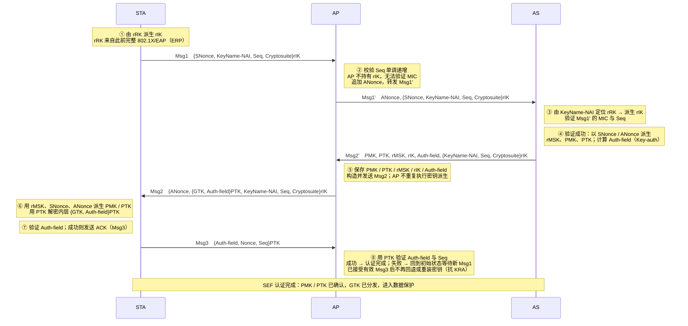

# SEF（Secure and Efficient FILS）认证协议 UML 序列图

> 依据：L. Zhang & M. Ma, “Secure and Efficient Fast Initial Link Setup Scheme Design”, IEEE WCNC 2019, Figure 1（SEF Mechanism）。
>
> 记法：`{…}rIK` = 用 rIK 计算的 MIC（仅完整性保护，不加密）；`{…}PTK` = 用 PTK/KEK 的 AEAD 加密；`Seq` = 单调递增序列号，用于防重放。

